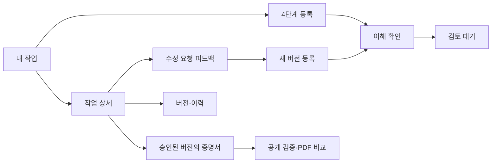

# HCI - GUI: 사용자 핵심 기능

## 설계 계약

대상은 AI 협업 결과물을 등록하는 작성자다. 반복 업무에서 작업의 현재 버전·상태·다음 행동을 먼저 읽게 한다. 시각 방향은 차분한 업무 도구이며, 공통 디자인 지침의 청록 주요 행동과 작은 빨강 가이드 강조를 적용한다. 장식 차트나 외부 이미지가 필요하지 않은 정보 중심 화면이다.

- 주요 진입점: `user/index.html`. 기존 HumanProof 시연 화면은 별도로 유지한다.
- 주요 흐름: 내 작업 → 4단계 등록 → 이해 확인 → 검토 상태 확인 → 수정 요청 시 새 버전 → 승인된 버전의 증명서 → 공개 검증.
- 주요 행동: 목록은 작업 등록, 등록은 검토 요청, 이해 확인은 답변 제출. 작성자에게 승인·철회 권한을 제공하지 않는다.
- 데스크톱 232px 사이드바·64px 상단 바·최대 1200px 본문. 1024px 미만은 모달 메뉴, 768px 미만은 한 열과 작업 카드.
- 확인할 화면 크기: 1440x1000, 1024x900, 768x1024, 360x800.
- 기준 문서: `docs/ui/DESIGN.md`와 사용자가 첨부한 동일한 v0.2 지침. 등록·기여·승인 대상 버전은 기존 프로젝트의 설계와 검증 코드를 참고한다.

## 화면과 사용자 행동

| 화면 | 사용자의 목표 | 주요 정보·행동 | 예외·다음 단계 |
| --- | --- | --- | --- |
| U01 내 작업 | 진행 상태와 다음 일 확인 | 검색·상태 필터·정렬, 버전·검토자·시각 | 빈 목록 → 등록; 검색 결과 없음 → 필터 초기화 |
| U02 작업 등록 | 결과물과 작업 맥락 제출 | ①PDF·작업명 ②AI 신고 ③나의 기여 ④검토자·요약 | 필드·PDF 검사, 이전 단계·임시 저장·이탈 확인 |
| U03 작업 상세 | 현재 버전과 검토 결과 확인 | 버전·상태·다음 행동, AI 사용·기여, 파일 해시 | 검토 대기는 읽기 전용, 수정 요청은 피드백과 새 버전 등록 |
| U04 이해 확인 | 설명과 판단 근거 남기기 | 설명·오류 발견·조건 변경 3문항, 답변·확신도 | 미완료 문항으로 이동; 임시 저장; 제출 후 검토 대기 |
| U05 새 버전 | 수정본 재제출 | 새 PDF, 변경 사유·신고·기여·검토자 | 새 ID·미승인 상태; 이전 버전과 승인 보존 |
| U06 증명서 | 승인된 대상 확인 | 버전·파일·승인자·시각, 다운로드·공개 링크 | 미발급 안내; 이전 승인과 최신 버전 구분 |
| U07 공개 검증 | 전달받은 파일의 동일성 확인 | 승인 효력 / 서명 / 파일 비교를 독립 표시 | 미제공·일치·불일치·검사 실패, 잘못된 링크 안내 |
| U08 버전·이력 | 변경 이유와 과거 대상 추적 | 버전·변경 사유·시각·파일·해시, 활동 이력 | 버전별 파일 다운로드; 과거 승인 덮어쓰기 금지 |

검토 대기 이후 실제 검토·승인은 후속 서버의 책임이다. 이 GUI는 작성자의 행동과 승인된 시연 자료의 조회를 구현한다. 독립 최종 승인자·관리자·팀 지식 연결·인수인계 과제는 전체 요구에 남으며 이 화면의 구현으로 대체하거나 삭제하지 않는다. 기존 검토자 프로토타입과 새 작성자 GUI의 저장 데이터는 자동 연동되지 않는다.

## 범위와 상태

새 사용자 GUI는 기존 PDF 형식·20 MB 상한·SHA-256 및 원자적 IndexedDB 저장 패턴을 재사용한다. 저장소는 별도 이름을 사용해 기존 시연 기록과 분리한다. 등록 파일·신고·기여 기록은 버전에 고정하며, 수정은 새 버전으로 만든다. 답변 제출은 검토 대기로 이동할 뿐 승인으로 이동하지 않는다.

서버 인증, 실제 검토자 전달, 과제 자동 생성·채점, 전자서명, 현재 승인 효력의 서버 조회는 연결하지 않는다. 승인된 작업은 명시된 시연 자료이며 사용자가 직접 승인할 수 없다. 세 문항은 고정 시연 문항이다. 실제 PDF 내용을 분석했다는 표현을 쓰지 않는다.

| 상태 | 진입 조건 | 화면 피드백과 회복 행동 |
| --- | --- | --- |
| 로딩 | 저장소 초기화·파일 검사·기록 저장 | 본문 로딩 안내, 진행 문구, 중복 제출 차단 |
| 빈 목록 | 검색/필터 결과 없음 또는 최초 작업 없음 | 서로 다른 안내, 필터 초기화 또는 작업 등록 |
| 오류 | 필수 누락·PDF 형식/크기 오류·저장 실패 | 오류 요약과 필드 연결, 입력 유지, 재시도 |
| 부분 결과 | 서명과 서버 효력 확인이 미연결 | 승인 시연 기록·서명 확인 불가·파일 비교를 별도로 표시 |
| 성공 | 로컬 저장과 답변 제출 완료 | 저장 완료 시각·상태 변경·다음 행동 |
| 권한 | 작성자가 검토 결과를 확인 | 읽기 전용 사유를 표시, 승인 액션 없음 |

## HCI 적용

| 원칙 | 적용 |
| --- | --- |
| 시스템 상태 가시성 | 목록 배지, 버전 요약, 다음 행동, 저장 결과·진행 안내 |
| 인지 부담 감소 | 등록을 파일/AI 신고/기여/검토자 네 단계로 나누고 입력을 유지 |
| 오류 예방·회복 | 필수 검사·파일 검사·최종 요약, 미저장 이탈 확인, 오류 시 입력 보존 |
| 사용자 통제 | 이전 단계·임시 저장·취소, 모달 Escape·취소·포커스 복귀 |
| 일관성 | 공통 토큰, 버튼·필드·상태 매핑, 상세 안 증명서·이력 |
| 접근성 | 본문 바로가기, 표 머리글, visible label, 오류 연결, 키보드 탭·메뉴, 44px 행동 영역 |
| 신뢰 범위 명확화 | 검토/승인/발급/파일 비교 분리, 서명 미연결 명시, 새 버전에 이전 승인 미적용 |

## 사용자 평가 계획

학생 5명에게 등록→이해 확인→수정 제출→증명서·파일 비교를 수행하게 한다. 완료 여부·소요 시간·도움 요청 수·현재 버전 승인 여부의 정답률을 기록한다. 실제 사용자 평가를 수행한 결과나 개선율을 주장하지 않는다. 브라우저에서 실시한 기능·반응형 점검은 별도 검증 기록에 남긴다.
