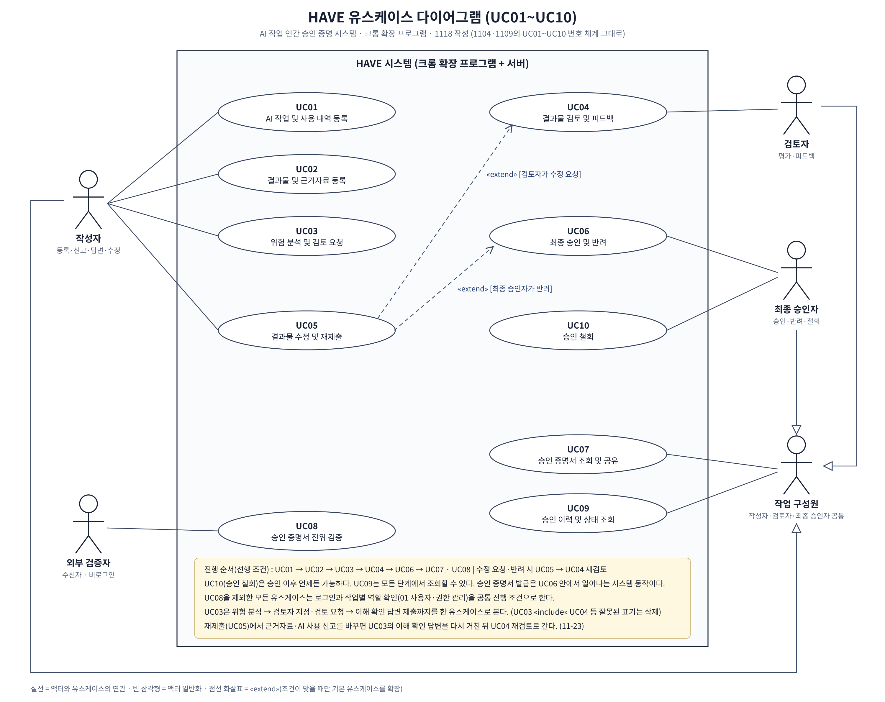

# HAVE 유스케이스 명세 (UC01~UC10)

2026-11-18 · 1104·1109의 유스케이스 번호 체계를 그대로 쓰고, 1116 HCI 프로토타입과 DB 설계에서 정해진 내용을 반영했다. 11-23에 기본 흐름의 모든 단계에 주어(액터 또는 시스템)를 적었다. 단계의 수와 내용은 그대로다. 11-23 팀원 피드백 반영: UC05에 선택 단계(근거자료·AI 사용 신고 수정)와 근거 변경 분기를 넣었고(46단계), UC07·UC08·UC10에 최신 버전 여부를 승인 효력과 따로 보여 주는 내용을 넣었다. 11-23 최종 점검: 크롬 확장 프로그램에 있던 공유 중지(UC07 · UC08), 기록 해시 체인 확인과 알림 목록(UC09)을 단계 문장과 대안 흐름에 넣었다. 단계 수는 그대로다. 이 문장들에서 클래스를 찾은 과정은 `02_클래스/HAVE_클래스_도출과정.md`에 있다. 다이어그램은 `HAVE_유스케이스_다이어그램.png`.

## 1. 액터

| 액터 | 설명 | 사용하는 화면 |
| --- | --- | --- |
| 작성자 | AI를 활용해 결과물을 만들고 등록·신고·답변·수정하는 사람 | 크롬 확장 측면 패널·팝업 |
| 검토자 | 작성자가 지정한 사람. 답변을 평가하고 결과물을 검토한다. 작성자 본인은 될 수 없다 | 크롬 확장 측면 패널 |
| 최종 승인자 | 검토를 통과한 버전을 승인·반려하고, 승인을 철회할 수 있는 사람 | 크롬 확장 측면 패널 |
| 작업 구성원 | 위 세 역할의 공통 상위 액터. 한 작업의 증명서와 이력을 볼 수 있다 | 크롬 확장 측면 패널 |
| 외부 검증자 | 증명서 링크·QR을 받은 수신자. 로그인하지 않는다 | 공개 검증 페이지 |

역할은 계정 전체가 아니라 작업별로 정해진다(`WorkMember.role`).

## 2. 유스케이스 사이의 관계

- 진행 순서(선행 조건): UC01 → UC02 → UC03 → UC04 → UC06 → UC07·UC08.
- UC05는 UC04(검토자가 수정 요청)와 UC06(최종 승인자가 반려)을 조건부로 확장한다(«extend»). 재제출 뒤에는 UC04 재검토로 돌아간다. 근거자료·AI 사용 신고를 바꿔 재제출하면 UC03의 이해 확인 답변을 다시 거친 뒤 UC04로 간다(11-23).
- UC10은 승인 이후 언제든 할 수 있고, UC09는 모든 단계에서 할 수 있다.
- UC08을 뺀 모든 유스케이스는 로그인과 작업별 역할 확인을 공통 선행 조건으로 한다.
- 1104의 "UC03 «include» UC04", "UC05 «include» UC06" 표기는 쓰지 않는다. «include»는 한 유스케이스가 실행될 때마다 다른 유스케이스의 동작이 그 안에서 반드시 실행된다는 뜻인데, 두 경우 모두 다른 액터가 나중에 따로 하는 일이다.

## 3. 유스케이스별 명세

기본 흐름의 각 단계는 "누가 무엇을 한다"로 적는다. 주어는 액터(작성자·검토자·최종 승인자·작업 구성원·외부 검증자) 또는 시스템이다.

### UC01 AI 작업 및 사용 내역 등록

| 항목 | 내용 |
| --- | --- |
| 주 액터 | 작성자 |
| 선행 조건 | 로그인 |
| 기본 흐름 | 1. 작성자가 새 작업을 선택한다. 2. 작성자가 제목과 AI 사용 신고(도구·모델·사용 방식·사용 범위 또는 "AI 미사용")를 입력한다. 3. 시스템이 입력을 검증하고 작업을 DRAFT로 저장한다. 4. 결과물 버전이 생기면(UC02) 작성자가 단계·주체·설명으로 기여 기록을 추가한다. 5. 시스템이 기여 타임라인을 보여 준다. |
| 대안·예외 | 입력 오류 → 400, 입력값을 유지하고 안내. 권한 없음·승인된 버전 → 403/409. |
| 후행 조건 | 작업(DRAFT)과 AI 신고 초안이 저장되고 감사 이벤트가 기록된다. |
| 화면 | 등록 2/5 · AI 사용 신고, 3/5 · 기여 기록 |

### UC02 결과물 및 근거자료 등록

| 항목 | 내용 |
| --- | --- |
| 주 액터 | 작성자 |
| 선행 조건 | UC01로 작업이 생성됨 |
| 기본 흐름 | 1. 작성자가 결과물 PDF를 선택한다(끌어다 놓기, 현재 탭의 PDF 가져오기 포함). 2. 시스템이 형식·크기(PDF, 20MB)를 검사하고 SHA-256을 계산한다. 3. 시스템이 파일을 비공개로 저장하고 버전을 만든다(AI 신고 사본 고정). 4. 시스템이 버전 번호와 해시를 보여 준다. 5. 작성자가 근거자료(URL, 참고 문헌, 프롬프트 기록, 파일)를 추가한다. |
| 대안·예외 | PDF 아님·20MB 초과·직전 버전과 동일 파일 → 400/409. DB 저장 실패 시 저장한 파일을 삭제한다. |
| 후행 조건 | 버전이 SUBMITTED가 된다. v2부터는 변경 사유를 함께 저장한다. |
| 화면 | 등록 1/5 · 결과물 파일, 3/5 · 근거자료 |

### UC03 위험 분석 및 검토 요청

| 항목 | 내용 |
| --- | --- |
| 주 액터 | 작성자 (검토자는 알림 수신) |
| 선행 조건 | 버전이 SUBMITTED |
| 기본 흐름 | 1. 작성자가 4개 지표 점수와 근거를 입력한다. 2. 시스템이 합계(0~10)로 등급(LOW·MEDIUM·HIGH)을 정하고 등급별 Gate 전략을 고른다. 3. 작성자가 검토자와 최종 승인자를 고르고 메시지·기한을 입력해 검토를 요청한다. 4. 시스템이 신청을 검증하고(위험 분석 있음, 자기 검토 아님, 진행 중 요청 없음) 등급에 맞는 이해 과제를 배정한다. 시스템이 버전을 CHALLENGE_PENDING으로 바꾸고 근거자료·AI 신고를 잠근다. 5. 작성자가 과제마다 답변(20자 이상)과 확신 정도를 입력하고 제출한다. 6. 시스템이 답변을 확정하고 버전을 REVIEW_PENDING으로 바꾼 뒤 검토자에게 알린다. |
| 대안·예외 | 점수 범위 오류, 신청 검증 실패 → 400/409. 답변 임시 저장 가능. 검토 시작 전에는 작성자가 요청을 취소할 수 있고 버전은 SUBMITTED로 돌아간다. |
| 후행 조건 | 위험 평가, 검토 요청, 과제, 답변이 저장된다. 통과 판정은 여기서 하지 않는다. |
| 화면 | 등록 4/5 · 위험 분석, 5/5 · 검토 요청, 이해 확인 |

### UC04 결과물 검토 및 피드백

| 항목 | 내용 |
| --- | --- |
| 주 액터 | 검토자 (작성자·최종 승인자는 알림 수신) |
| 선행 조건 | 버전이 REVIEW_PENDING, 지정된 검토자 |
| 기본 흐름 | 1. 검토자가 검토할 작업을 열고 검토를 시작한다. 2. 시스템이 파일 해시를 등록 당시 값과 대조하고, 일치하면 버전을 잠근다(IN_REVIEW). 3. 검토자가 답변마다 점수(0~2)·근거·치명 오류 여부를 입력한다. 4. 검토자가 자료를 확인하고 체크리스트 4항목을 확인한다. 5. 검토자가 검토 메모와 보완 요청 항목을 쓴다. 6. 검토자가 검토 통과 또는 수정 요청을 고른다. |
| 대안·예외 | 해시 불일치 → 검토 중지, 위·변조 경고, 감사 기록. 통과 조건(등급별 Gate 기준, 치명 오류 없음, 체크 4/4, 보완 항목 없음, 메모) 미충족 → 통과 불가 사유 안내. |
| 후행 조건 | 통과 → APPROVAL_PENDING, 최종 승인자·작성자 알림. 수정 요청 → REVISION_REQUIRED, 보완 항목·기한 저장, 작성자 알림(UC05로 확장). |
| 화면 | 검토 (자료 / 평가 / 체크리스트 / 피드백 탭) |

### UC05 결과물 수정 및 재제출

| 항목 | 내용 |
| --- | --- |
| 주 액터 | 작성자 (검토자는 알림 수신) |
| 선행 조건 | 버전이 REVISION_REQUIRED (검토자의 수정 요청 또는 최종 승인자의 반려) |
| 기본 흐름 | 1. 작성자가 피드백(또는 반려 사유)과 보완 기한을 확인한다. 2. 작성자가 수정 파일과 변경 요약을 입력한다. 3. 작성자가 피드백 항목마다 반영 여부와 답변을 쓴다. 4. (선택) 작성자가 근거자료와 AI 사용 신고를 고친다. 5. 작성자가 재제출한다. 6. 시스템이 새 버전 v(N+1)을 만들고(이전 버전·검토 기록 보존) 근거 변경을 판정해, 근거자료·AI 신고가 그대로면 REVIEW_PENDING, 바뀌었으면 CHALLENGE_PENDING으로 두고 재검토 요청을 연결한다. |
| 대안·예외 | 형식 오류·20MB 초과·동일 파일 → 오류 안내. 답변하지 않은 피드백이 있으면 재제출 불가. 근거 변경(근거자료의 유형·주소·파일 해시 또는 AI 사용 신고가 직전 버전과 다름) → 이전 답변을 그대로 적용할 수 없으므로 새 버전이 CHALLENGE_PENDING에서 시작하고, 작성자가 이해 확인 답변을 다시 제출한다(UC03 흐름). 이전 답변은 출처 버전(v N)을 붙인 참고 자료로 보여 준다. |
| 후행 조건 | 위험 평가와 이해 과제는 새 버전으로 사본 승계된다. 근거가 그대로면 답변도 사본 승계되고 검토자에게 바로 알림, 바뀌었으면 답변은 비워 두고 답변 제출 뒤 검토자에게 알림. 평가 점수는 초기화되고 승인은 승계되지 않는다. |
| 화면 | 수정본 재제출 |

### UC06 최종 승인 및 반려

| 항목 | 내용 |
| --- | --- |
| 주 액터 | 최종 승인자 |
| 선행 조건 | 버전이 APPROVAL_PENDING, 지정된 최종 승인자 |
| 기본 흐름 | 1. 최종 승인자가 승인 버전·파일·검토 결과와 승인 조건 5개(지정 승인자, 검토 통과, 버전 일치, 파일 해시 일치, 기존 결정 없음)를 확인한다. 2. 최종 승인자가 최종 승인을 누르고 확인 창에서 확정한다. 3. 시스템이 권한(자기 승인 금지), 멱등성 키, 검토 통과, 파일 해시 일치를 확인하고 승인·증명서(PENDING)·발급 요청을 한 트랜잭션으로 저장한다. 4. 시스템이 버전을 APPROVED로 바꾸고 증명서 발급을 비동기로 진행한다. |
| 대안·예외 | 반려 → 사유 필수, REVISION_REQUIRED, UC05로 확장. 조건 미충족·충돌 → 차단 사유 안내. 같은 키의 재요청 → 기존 결과 반환. 발급 실패 → "승인은 완료됐지만 증명서 발급에 실패했어요"(UC07에서 재시도). |
| 후행 조건 | 승인 기록과 증명서 레코드가 생긴다. 작성자·검토자 알림. |
| 화면 | 최종 승인 |

### UC07 승인 증명서 조회 및 공유

| 항목 | 내용 |
| --- | --- |
| 주 액터 | 작업 구성원 |
| 선행 조건 | 승인된 버전이 있음 |
| 기본 흐름 | 1. 작업 구성원이 증명서 탭을 연다. 2. 시스템이 발급 상태와 승인 효력, 최신 버전 여부, 승인자·시각·대상 버전·해시를 보여 준다. 3. 작업 구성원이 만료일을 골라 공유 링크를 만든다. 4. 작업 구성원이 링크를 복사하거나 QR을 내려받는다. |
| 대안·예외 | 발급 중 → 안내. 발급 실패 → 발급 재시도. 구성원이 아니면 조회 불가. 더 쓰지 않을 링크는 작업 구성원이 확인 창을 거쳐 공유를 중지한다 → 링크 DISABLED, 그 링크로 연 공개 검증은 대상 미식별(승인 효력과 다른 링크는 그대로). |
| 후행 조건 | 공유 링크(토큰 해시, 만료)가 저장되고 이력이 기록된다. QR은 저장하지 않는다. 공유를 중지하면 중지 시각(disabledAt)과 이력이 남는다. |
| 화면 | 작업 상세 · 증명서 탭 |

### UC08 승인 증명서 진위 검증

| 항목 | 내용 |
| --- | --- |
| 주 액터 | 외부 검증자 (로그인 없음) |
| 선행 조건 | 공유 링크·QR 또는 증명서 번호를 가지고 있음 |
| 기본 흐름 | 1. 외부 검증자가 공유 링크·QR 또는 증명서 번호로 공개 검증 페이지에 들어온다. 2. (선택) 외부 검증자가 가진 PDF를 고르면 공개 검증 페이지가 기기에서 SHA-256만 계산한다. 3. 시스템이 서명 검증, 현재 승인 효력, 파일 해시 비교를 각각 판정한다. 4. 시스템이 세 판정과 최신 버전 여부, 확인 시각을 따로 보여 준다. |
| 대안·예외 | 증명서 없음·링크 만료·공유 중지 → 대상 미식별 안내. 네트워크 오류 → 세 판정 모두 "확인 불가"(철회·불일치로 바꾸지 않음). 파일을 올리지 않으면 "파일 미확인". 승인이 철회됐고 후속 버전도 있으면 둘 다 표시한다(예: "v1 승인 철회 · 후속 버전 v2 있음 · 선택 파일은 v1과 일치"). |
| 후행 조건 | 검증 조회가 행위자 없는 감사 이벤트로 기록된다. 답변 원문·내부 의견·비공개 파일 주소는 반환하지 않는다. |
| 화면 | 공개 검증 페이지 |

### UC09 승인 이력 및 상태 조회

| 항목 | 내용 |
| --- | --- |
| 주 액터 | 작업 구성원 |
| 선행 조건 | 로그인, 해당 작업의 구성원 |
| 기본 흐름 | 1. 작업 구성원이 측면 패널에서 내 작업·검토할 작업·승인할 작업 목록과 현재 상태를 본다. 2. 작업 구성원이 작업을 고르고 이력 탭을 연다(버전·유형 필터). 3. 시스템이 행위자·행동·버전·시각·사유를 시간 역순으로 보여 주고, 기록 해시 체인이 끊긴 곳이 없는지 확인해 함께 표시한다. |
| 대안·예외 | 구성원이 아니면 내용 노출 없이 권한 안내. 조건에 맞는 기록이 없으면 빈 상태 안내. 해시 체인이 끊겼으면 경고를 표시한다. (선택) 작업 구성원이 알림 탭에서 받은 알림 목록을 보고 알림을 열면, 시스템이 읽음으로 표시하고 해당 작업으로 이동한다. |
| 후행 조건 | 작업 버전·검토·승인·증명서의 상태는 바뀌지 않는다(조회). 알림을 열면 읽음 시각만 기록된다. |
| 화면 | 작업 목록, 작업 상세 · 이력 탭, 알림 |

### UC10 승인 철회

| 항목 | 내용 |
| --- | --- |
| 주 액터 | 최종 승인자 |
| 선행 조건 | 철회되지 않은 승인이 있음 |
| 기본 흐름 | 1. 최종 승인자가 검토·승인 탭에서 승인 철회를 고른다. 2. 최종 승인자가 확인 창에서 대상 승인·버전과 영향을 확인하고 사유를 입력한다. 3. 시스템이 권한, 멱등성 키, 미철회 여부를 확인하고 철회 기록을 저장한다. |
| 대안·예외 | 사유 누락·권한 없음·이미 철회 → 변경 없음. 같은 키의 재요청 → 기존 결과 반환. |
| 후행 조건 | 승인 효력이 REVOKED가 된다. 작업 상태(APPROVED), 원본 승인, 증명서, 이력은 그대로 남는다. 작성자·검토자 알림. 공개 검증은 "승인 철회"로 표시한다. 후속 버전이 있어도 철회 표시는 가려지지 않고, 최신 버전 여부는 따로 표시한다. |
| 화면 | 작업 상세 · 검토·승인 탭 |
