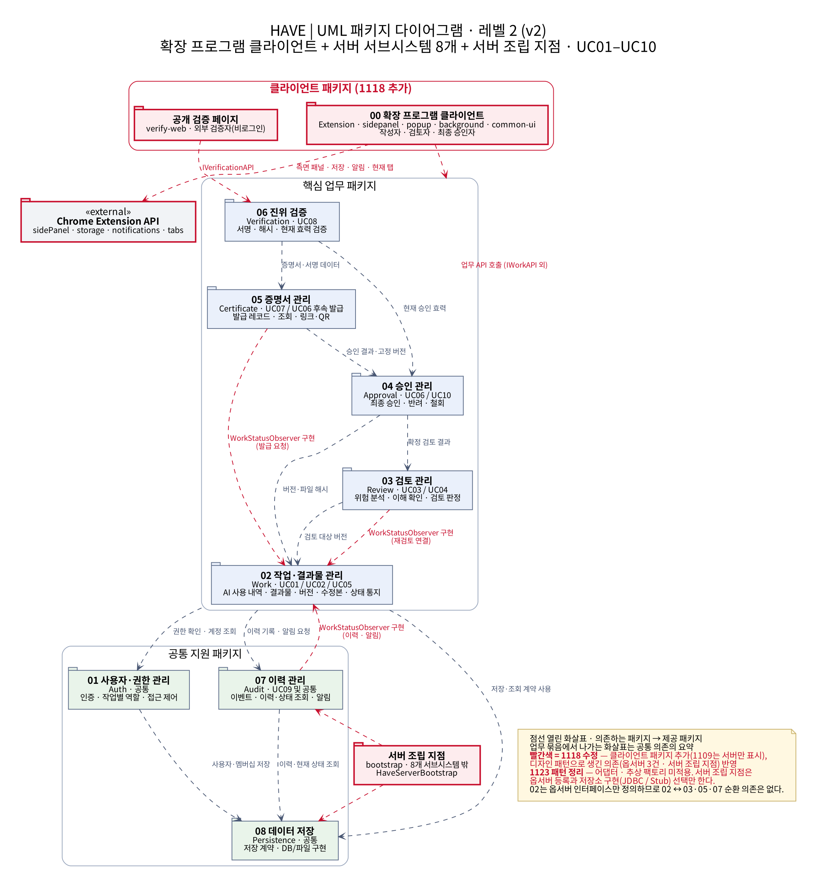

# HAVE 서브시스템 정의와 구조유형(아키텍처) 설계 v2

2026-11-18 · 1109의 `HAVE 서브시스템 통합 정의서`와 `HAVE-구조유형-설계`를 합치고 후속 단계(디자인 패턴, HCI, DB)의 결정을 반영한 수정본.

> v2에서 바뀐 것 — ① 클라이언트를 "업무 웹 UI"에서 크롬 확장 프로그램(측면 패널·팝업·서비스 워커)으로 정정 ② 과제 필수 항목인 "문제와 선택한 이유"를 1부 앞에 추가 ③ 1109에서 '보완 제안'으로 남겼던 항목 중 뒤 단계에서 확정된 것을 '반영'으로 정리 ④ 서브시스템 정의에 이해 확인, 알림 목록, 추가 타입을 반영 ⑤ (11-23 패턴 정리) 어댑터 · 추상 팩토리 패턴을 적용하지 않기로 해 3절 · 5절의 표현과 타입 수를 고침(서버 타입 85개 → 79개). ⑥ (11-23 보강) 1절 표에 품질 속성 열, 2절 MVC를 부분 채택(클라이언트 내부)으로, 7절 추적표(유스케이스 → 기능 → 컴포넌트 → 구조) 추가. ⑦ (11-23 팀원 피드백) 승인 트랜잭션 범위(옵서버의 저장까지 한 트랜잭션)를 명시하고, 공개 검증에 최신 버전 여부를 승인 효력과 따로 표시하며, 재제출 때 근거가 바뀌면 이해 확인(CHALLENGE_PENDING)부터 다시 하도록 추적표와 인터페이스 설명을 고침.

## 1. 풀어야 할 문제

HAVE는 AI로 만든 결과물의 검토·승인 근거를 특정 파일 버전에 묶어 두고, 받은 사람이 QR로 승인 상태와 파일 일치 여부를 확인하게 하는 서비스다. 구조를 고를 때 다음 요구와 제약이 기준이 됐다.

| 번호 | 요구·제약 | 품질 속성 (비기능 요구) | 출처 |
| --- | --- | --- | --- |
| P1 | 작성자·검토자·최종 승인자가 기존 작업 화면(드라이브의 PDF 등) 옆에서 일해야 한다 | 사용성 — 작업 흐름을 끊지 않음 | 계획서 16쪽 "웹 확장프로그램", 프로젝트 설명 |
| P2 | 외부 수신자는 설치·로그인 없이 검증해야 한다 | 사용성 · 접근성 — 설치 · 로그인 없음 | UC08 |
| P3 | 승인 기록, 서명 키, 감사 이력은 사용자 기기가 아니라 한곳에서 지켜야 한다. 사용자가 고칠 수 있으면 증명이 되지 않는다 | 보안 · 무결성 — 기록의 단일 출처 | 계획서 30쪽 "서버 운영자가 서명 키와 DB를 관리" |
| P4 | 한 번 승인된 버전의 파일과 기록은 바뀌지 않아야 하고, 수정은 새 버전으로만 한다 | 무결성 · 감사 가능성 — 불변 기록 | 계획서 9쪽, UC05 |
| P5 | 4명이 8주 안에 나눠 개발하고 단계적으로 합쳐야 한다 | 개발 분담성 · 통합 용이성 | 계획서 27~29쪽 WBS |
| P6 | 상태가 바뀔 때마다 이력 기록·알림·증명서 발급이 빠짐없이 뒤따라야 한다 | 신뢰성 — 후속 처리 누락 없음 | 서브시스템 정의 7, UC09 |
| P7 | 저장소(DB·파일)와 알림 채널은 개발 중에 바뀔 수 있다 | 변경 용이성 (유지보수성) | 계획서 20쪽 "인프라·도구" |

P1~P7은 모두 기능이 아니라 품질에 관한 요구(비기능 요구)다. 기능 요구는 유스케이스 UC01~UC10이 맡고, 구조유형은 이 비기능 요구를 기준으로 골랐다(Ch07 part1 수정판 p.6 주석 "비기능 요구 사항 위주로").

## 2. 후보 구조유형과 선택

강의(Lecture #7 part1)의 아키텍처 스타일을 위 문제에 대입했다.

| 구조유형 | 맞는 점 | 맞지 않는 점 | 판단 |
| --- | --- | --- | --- |
| 클라이언트–서버 | P1·P2(얇은 클라이언트 둘), P3(기록을 서버가 관리) | 서버 병목·단일 장애점 | **채택 (전체 구조)** |
| 계층형 | P5(계층·모듈별 분담), P7(저장 계층 교체) | 모든 요청이 전 계층을 거치면 느려짐 | **채택 (서버 내부, 느슨한 계층)** |
| 이벤트 기반 | P6(상태 변경 뒤처리를 느슨하게 연결) | 전체를 이벤트로 만들면 흐름 추적이 어려움 | **부분 채택 (상태 변경 통지와 증명서 발급)** |
| MVC | 확장 프로그램은 입력 · 상태 표시가 많은 인터랙티브 앱이라 화면과 규칙을 나눠야 함(P1) | 서버는 화면을 만들지 않음 | **부분 채택 (클라이언트 내부)** |
| 저장소(데이터 중심) | 공유 데이터 중심 | 모듈이 DB에 직접 붙으면 P4의 불변 규칙을 지키기 어려움 | 미채택 (DB는 08을 통해서만 접근) |
| 파이프–필터 | 단계적 변환 | 검토·수정·반려처럼 되돌아가는 흐름이 많음 | 미채택 |
| P2P · 브로커 · 마이크로커널 | 분산·확장 | 승인 기록의 단일 출처(P3)와 4명·8주 규모(P5)에 과함 | 미채택 |

**선택: 클라이언트–서버 + (서버 내부) 느슨한 계층형 + 상태 변경에 한정한 이벤트 기반 + (클라이언트 내부) MVC.**

선택한 이유를 문제 번호로 정리하면 다음과 같다.

- P1·P2 — 클라이언트를 둘로 나눈다. 업무용은 크롬 확장 프로그램(측면 패널 400px, 팝업 360px), 검증용은 누구나 여는 공개 웹 페이지다. 둘 다 화면과 입력 검사만 맡는다.
- P3·P4 — 승인·서명·감사 이력은 서버만 쓴다. 클라이언트가 계산하는 것은 파일의 SHA-256뿐이고, 서버가 등록 당시 값과 다시 대조한다.
- P5 — 서버를 기능 책임으로 8개 서브시스템으로 나누고 제공·요구 인터페이스로만 연결한다. 한 사람이 한 서브시스템을 맡아도 다른 쪽이 끝나기를 기다리지 않는다(스텁으로 대체, 디자인 패턴의 브리지).
- P6 — 작업 상태가 바뀌는 지점을 한곳(02의 `setWorkStatus`)으로 모으고, 이력·알림·발급 요청·재검토 연결은 그 통지를 받는 쪽이 처리한다(옵서버). 증명서 발급은 승인과 같은 트랜잭션에 발급 요청을 남기는 Transactional Outbox로 놓치지 않게 한다. 옵서버는 상태를 바꾼 서비스의 트랜잭션 안에서 동기로 행만 저장하고(실패하면 전체 롤백), 서명과 알림 전송은 커밋 뒤 처리기가 맡는다(11-23).
- P7 — 저장과 외부 연계는 08과 07의 계약 뒤에 숨긴다(Repository · FileStore · INotification 계약). 업무 서비스는 계약만 알고, 구현은 서버 조립 지점에서 넣는다.
- P1 (클라이언트 내부) — 확장 프로그램은 MVC로 나눈다. 강의에서 MVC는 인터랙티브 앱을 만들 때 쓰는 구조다(Ch07 part1 p.17 주석). 서버는 화면을 만들지 않으므로 MVC는 클라이언트에만 해당한다.

| MVC 요소 | 확장 프로그램의 파일 | 하는 일 |
| --- | --- | --- |
| Model | model.js · review-model.js · storage.js | 작업 · 버전 · 검토 · 승인 상태와 규칙(상태 전이, 입력 검사, 승인 조건), 브라우저 저장 |
| View | app.js · registration.js · review-ui.js의 show… 함수 | 상태를 받아 화면 HTML을 만든다. 규칙을 직접 바꾸지 않는다 |
| Controller | app.js의 click · input · change · submit 처리 | 사용자 행동을 Model 오퍼레이션으로 바꾸고, 저장한 뒤 View를 다시 그린다 |

화면 규칙이 바뀌어도(예: 측면 패널 400px → 전체 탭) View만 고치고, 승인 조건 같은 규칙이 바뀌어도 Model만 고친다. 서버가 생기면 Model의 오퍼레이션 이름(컴포넌트 v2의 인터페이스와 같다)을 서버 API 호출로 바꾸면 된다.

치르는 대가는 서버가 단일 장애점이라는 것이다. 서버가 멈추면 공개 검증도 멈춘다. 그래서 검증 화면은 네트워크 오류를 "확인 불가"로 표시하고 철회나 불일치로 바꾸지 않는다.

## 3. 서브시스템 정의

클라이언트 2개와 서버의 논리 서브시스템 8개다. 서버 서브시스템은 배포 단위가 아니라 기능 책임에 따른 논리적 분할이다.

### 클라이언트

| 구성 | 책임 | 사용자 |
| --- | --- | --- |
| 크롬 확장 프로그램 | 측면 패널(목록·등록·이해 확인·검토·수정·승인·증명서·이력·알림), 팝업(지금 할 일, 현재 탭 PDF 등록, 검증 진입), 서비스 워커(API 호출, 세션, 브라우저 알림, 현재 탭 PDF 가져오기) | 작성자·검토자·최종 승인자 |
| 공개 검증 페이지 | 승인 효력·서명 검증·파일 비교와 최신 버전 여부 표시, 기기 내 해시 계산 | 외부 검증자 |

### 서버

| 번호 | 서브시스템 | 책임 | 주요 기능 | 유스케이스 |
| --- | --- | --- | --- | --- |
| 01 | 사용자·권한 관리 (Auth) | 인증과 작업별 역할 기반 접근 제어 | 로그인·로그아웃, 사용자 식별, 작성자·검토자·최종 승인자 권한 확인 | 공통 |
| 02 | 작업·결과물 관리 (Work) | 작업, 결과물 버전의 수명주기와 작업 상태 | AI 사용 내역 등록, 결과물·근거자료 저장, 버전 생성, 수정본 재제출, 작업 목록·상세 조회, **상태 변경 통지** | UC01, UC02, UC05 |
| 03 | 검토 관리 (Review) | 위험 분석, 이해 확인, 검토 판정 | 위험 점수·등급, 검토자 지정, **이해 과제 배정·답변 접수**, 답변 평가, 체크리스트, 피드백, 수정 요청, 검토 통과 | UC03, UC04 |
| 04 | 승인 관리 (Approval) | 최종 승인·반려·철회 결정 | 승인 조건 확인, 승인·반려 기록, 승인 버전 확정, 철회와 사유 기록, 멱등 처리 | UC06, UC10 |
| 05 | 증명서 관리 (Certificate) | 승인된 버전의 증명서 발급·조회·공유 | 증명서 발급·재시도, 조회, 공유 링크·QR·**공유 중지** | UC07 (발급은 UC06 승인 성공 후) |
| 06 | 진위 검증 (Verification) | 외부 검증자의 진위·현재 효력 확인 | 서명 검증, 승인 효력·최신 버전 확인, 파일 해시 비교, 결과 반환 | UC08 |
| 07 | 이력 관리 (Audit) | 추적 가능한 이력과 알림 | 이벤트 기록(해시 체인), 이력·현재 상태 조회, **해시 체인 확인**, **알림 발송과 알림 목록** | UC09 (기록은 전 구간) |
| 08 | 데이터 저장 (Persistence) | 업무 데이터와 파일의 영속화 | 저장 계약(Repository 7종, FileStore), DB·파일 구현 | 공통 |

굵은 글씨가 1109 정의서에서 달라진 부분이다. 알림 규칙은 `HAVE_용어_상태_통일표` 6절에 있다.

## 4. 서브시스템 간 구조

그림 1. 서브시스템 간 구조(패키지 다이어그램 레벨 2 v2). 점선 화살표는 의존하는 쪽에서 제공하는 쪽을 향한다.

업무의 진행 순서는 Work → Review → Approval → Certificate → Verification이지만 의존 방향은 필요한 데이터를 제공하는 쪽을 향한다.

| 의존하는 쪽 → 제공하는 쪽 | 인터페이스 | 목적 |
| --- | --- | --- |
| 확장 프로그램 → 02·03·04·05·07·01 | IWorkAPI, IReviewAPI, IApprovalAPI, ICertificateAPI, IHistoryQuery, INotificationQuery, IAuthorization | 업무 요청, 이력·알림 조회, 로그인 |
| 공개 검증 페이지 → 06 | IVerificationAPI | 검증 요청 |
| 03 → 02 | IWorkVersion | 검토 대상 버전 조회, 작업 상태 갱신 |
| 04 → 02 | IWorkVersion | 승인 대상의 버전·파일 해시 확인, 작업 상태 갱신 |
| 04 → 03 | IReviewResult | 확정된 검토 결과와 통과 여부 |
| 05 → 04 | IApprovalStatus | 승인 결과와 발급 근거 |
| 06 → 05 | ICertificateData | 증명서 데이터와 서명 |
| 06 → 04 | IApprovalStatus | 현재 승인 효력(철회 여부)과 최신 버전 번호 |
| 03·05·07 → 02 | WorkStatusObserver (02가 정의, 03·05·07이 구현) | 상태 변경 통지 수신: 재검토 연결 / 발급 요청 / 이력·알림 |
| 02~05 → 01, 02~06 → 07, 01~05·07 → 08 | IAuthorization, IAuditLog·INotification, IPersistence·FileStore | 권한, 이력·알림, 저장 |

02는 옵서버 인터페이스만 정의하고 구현 클래스를 알지 못하므로 02와 03·05·07 사이에 순환 의존은 없다. 옵서버 등록은 서버 조립 지점(bootstrap)에서 한다. 1109 문서는 수정·재제출에서 "RevisionService가 재검토 요청을 조정한다"고 썼는데, 그대로 하면 02 → 03 의존이 생겨 03 → 02와 순환한다. v2는 02가 상태만 바꾸고 03의 `ReReviewObserver`가 새 버전에 검토 요청을 연결하도록 정리했다.

## 5. 서브시스템 내부 구조

서버 내부에는 Service Layer + Domain Model + Repository를 쓴다. 요청 진입점(Controller)이 입력을 해석해 서비스를 부르고, 서비스가 유스케이스의 순서·권한 확인·다른 서브시스템 호출·저장을 조정하며, 도메인 모델과 정책이 업무 규칙을 가진다. 저장은 08의 계약만 쓴다.

| 서브시스템 | 내부 구성 | 적용 구조·패턴 |
| --- | --- | --- |
| 01 Auth | 정책: AuthorizationPolicy / 모델: User, WorkMember | Policy + Domain Model |
| 02 Work | 진입점: WorkController, ContributionController, VersionController, EvidenceController / 서비스: WorkService, ContributionService, VersionService, EvidenceService, RevisionService / 모델: Work, WorkVersion, AiDisclosure, AiToolUsage, Contribution, EvidenceItem, Revision, FeedbackResponse / 상태 통지: Subject, WorkStatusSubject, WorkStatusObserver, StatusChange | Controller + Service Layer + Domain Model, 옵서버(Subject) |
| 03 Review | 진입점: RiskController, ReviewRequestController / 서비스·정책: RiskService, GatePolicy, ReviewRequestService, ReviewService / 모델: RiskAssessment, ReviewRequest, Challenge, ChallengeResponse, Evaluation, Review, ChecklistItem, ReviewCheck, Feedback, FeedbackItem / 전략: GateStrategy, LowRiskGate, MediumRiskGate, HighRiskGate / 옵서버: ReReviewObserver | Controller + Service Layer + Domain Model, 전략, 옵서버 |
| 04 Approval | 서비스: ApprovalService / 모델: ApprovalCase, Approval, Revocation, OutboxEvent | Service Layer + Domain Model, Transactional Outbox |
| 05 Certificate | 서비스: CertificateService / 모델: Certificate, ShareLink, QRCode / 옵서버: CertificateIssueObserver | Service Layer + Domain Model, 옵서버 |
| 06 Verification | 서비스: VerificationService / 결과 모델: VerificationResult | Service Layer |
| 07 Audit | 서비스·연계: AuditLogService, HistoryService, NotificationGateway / 모델: AuditEvent, Notification / 옵서버: AuditLogObserver, NotificationObserver | 기록·조회 분리 + Gateway(알림 발송), 옵서버 |
| 08 Persistence | 계약: Repository‹T›, ReviewRepository, RevisionRepository, ApprovalRepository, CertificateRepository, HistoryRepository, UserRepository, WorkRepository, FileStore / 구현: JdbcPersistence, StubPersistence, JsonFilePersistence, DatabaseConnectionPool, StorageFileStore | Repository(저장 계약과 구현 분리), 브리지, 싱글톤 |
| bootstrap | HaveServerBootstrap | 서버 조립 지점: 옵서버 등록, 저장소 구현(JDBC / Stub) 선택 |

서버 타입은 79개다(1109 원자료 53 + 디자인 패턴·인프라 18 + 1118 추가 8). 11-23 패턴 정리로 85개에서 6개를 뺐다(디자인 패턴 문서 4장 · 6장). 소속은 패키지 다이어그램 레벨 3 v2에 그렸다.

## 6. 일관성 규칙 — 1109의 '보완 제안'이 어떻게 됐는가

| 1109의 보완 제안 | 뒤 단계의 결정 | 상태 |
| --- | --- | --- |
| 승인 후 자동 발급: Approval이 승인과 발급 이벤트를 같은 트랜잭션에 저장 | CertificateIssueObserver가 APPROVED 통지를 받아 OutboxEvent 저장(디자인 패턴 7장), DB에 OUTBOX_EVENT, 재시도는 `ICertificateAPI.retryIssue` | 반영 |
| 중복 처리 방지: IApprovalAPI의 key를 멱등성 키로 사용 | 클래스·DB에 저장 위치가 없었음 → ApprovalCase.decisionKey, Revocation.requestKey 추가(유일) | 1118 반영 |
| 버전과 효력의 일관성: 승인된 버전은 불변, 검증에서 서명·해시와 현재 효력을 분리, 후속 버전 여부도 효력과 따로 표시(11-23) | 작업 상태와 승인 효력을 분리(통합 상태 다이어그램 ①·④), 공개 검증은 세 판정을 독립 표시 | 반영 |
| 패키지 경계: 다른 모듈의 구현·테이블에 직접 접근하지 않음 | 브리지 적용으로 업무 서비스는 Repository만 사용. 01·02용 UserRepository·WorkRepository 추가 | 1118 반영 |
| Auth의 구체적인 인증 처리 | 프로토타입도 시연 계정 전환으로 대체 | 미정 (팀 확인) |

## 7. 추적표 — 유스케이스 → 기능 → 컴포넌트 → 구조 (11-23)

11-23 최종 점검: UC07에 공유 중지(disableShareLink), UC09에 기록 해시 체인 확인(isChainValid)과 알림 읽음(setRead)을 더했다. 오퍼레이션 이름은 컴포넌트 다이어그램 v2의 인터페이스 표와 같다.

유스케이스가 어떤 기능(오퍼레이션)으로 실현되고, 그 기능을 어느 인터페이스와 서브시스템이 맡으며, 구조유형의 어느 요소와 어느 문제(P1~P7)에 해당하는지를 한 줄로 잇는다(Ch06 p.14 주석 "유스케이스>>기능>>컴포넌트>>아키텍처 간의 연결"). 오퍼레이션 이름은 컴포넌트 다이어그램 v2의 인터페이스 표와 같고, 업무 화면은 모두 크롬 확장 프로그램(UC08만 공개 검증 페이지)이다.

| 유스케이스 | 기능 (오퍼레이션) | 인터페이스 → 컴포넌트(서브시스템) | 구조유형 요소 | 문제 |
| --- | --- | --- | --- | --- |
| UC01 AI 작업 및 사용 내역 등록 | createWork, addContribution | IWorkAPI → 02 Work (WorkController · WorkService · ContributionService) → 08 WorkRepository · 07 IAuditLog | 클라이언트–서버 · 서버 계층 | P1 P5 |
| UC02 결과물 및 근거자료 등록 | uploadVersion, addEvidence | IWorkAPI → 02 Work (VersionService · EvidenceService) → 08 FileStore · WorkRepository | 서버 계층 · 상태 통지(SUBMITTED) | P1 P4 P7 |
| UC03 위험 분석 및 검토 요청 | assessRisk, requestReview, cancelRequest, getChallenges, submitAnswers | IReviewAPI → 03 Review (RiskService · GatePolicy · ReviewRequestService) → 02 IWorkVersion · 01 IAuthorization · 08 | 서버 계층 · 상태 통지 · 전략 패턴 | P5 P6 |
| UC04 결과물 검토 및 피드백 | startReview, saveReviewDraft, submitReview, requestRevision | IReviewAPI → 03 Review (ReviewService) → 02 IWorkVersion(getVersionHash · setWorkStatus) · 08 | 서버 계층 · 상태 통지 | P4 P6 |
| UC05 결과물 수정 및 재제출 | resubmit (isBasisChanged) | IWorkAPI → 02 Work (RevisionService · VersionService) → 03 ReReviewObserver(WorkStatusObserver) · 08 | 서버 계층 · 상태 통지(재검토 연결, 근거가 바뀌면 이해 확인부터) | P4 P6 |
| UC06 최종 승인 및 반려 | getApprovalCase, approve, reject | IApprovalAPI → 04 Approval (ApprovalService) → 03 IReviewResult · 02 IWorkVersion · 08 → 05 CertificateIssueObserver(Outbox) | 서버 계층 · 상태 통지 · Transactional Outbox | P3 P4 P6 |
| UC07 승인 증명서 조회 및 공유 | getCertificate, retryIssue, createShareLink, createQRCode, disableShareLink | ICertificateAPI → 05 Certificate (CertificateService) → 04 IApprovalStatus · 08 · 07 IAuditLog | 클라이언트–서버 · 서버 계층 | P3 P6 |
| UC08 승인 증명서 진위 검증 | verify, verifyByQR | 공개 검증 페이지 → IVerificationAPI → 06 Verification (VerificationService) → 05 ICertificateData · 04 IApprovalStatus · 07 IAuditLog | 클라이언트–서버 (얇은 클라이언트) · 서버 계층 | P2 P3 |
| UC09 승인 이력 및 상태 조회 | getWorks, getHistory, isChainValid, getLatestStatus, getNotifications, setRead | IWorkAPI · IHistoryQuery · INotificationQuery → 02 Work · 07 Audit (HistoryService · NotificationGateway) → 08 | 서버 계층 (기록 · 조회 분리) | P3 P6 |
| UC10 승인 철회 | revoke | IApprovalAPI → 04 Approval (ApprovalService) → 07 IAuditLog · INotification · 08 | 서버 계층 (상태 변경이 아니라 직접 기록 · 알림) | P3 P4 |

- 클라이언트–서버: 모든 유스케이스가 클라이언트에서 서버 인터페이스를 부른다. 승인 · 서명 · 이력은 서버에만 있다(P3).
- 서버 계층: 진입점 → 서비스 → 도메인 모델 → 08 저장 계약 순서로 내려간다. 다른 서브시스템은 인터페이스로만 부른다(P5).
- 상태 통지(이벤트 기반): 작업 버전 상태를 바꾸는 UC02~UC06은 02의 `setWorkStatus`를 거쳐 옵서버가 이력 · 알림 · 발급 요청 · 재검토 연결을 처리한다(P6). UC10은 상태를 바꾸지 않으므로 ApprovalService가 직접 기록 · 알림한다.

## 작성 근거

1109 `HAVE 서브시스템 통합 정의서`, `HAVE-구조유형-설계`, `HAVE_디자인패턴_적용분석`, 1104 UC04·UC05 패키지·컴포넌트 다이어그램(Chrome 확장 구성), 1116 프로젝트 계획서, HCI 프로토타입, DB 설계, 1118 패키지·컴포넌트 다이어그램 v2.
