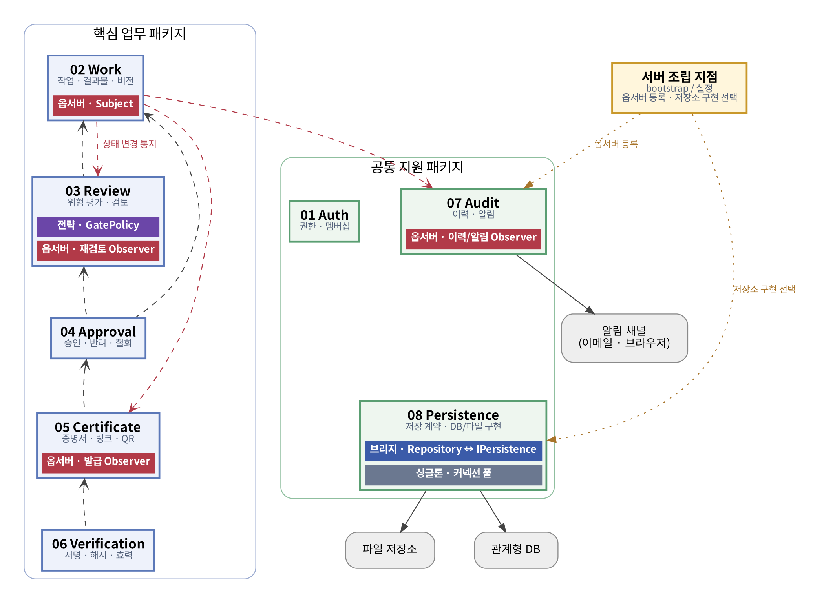
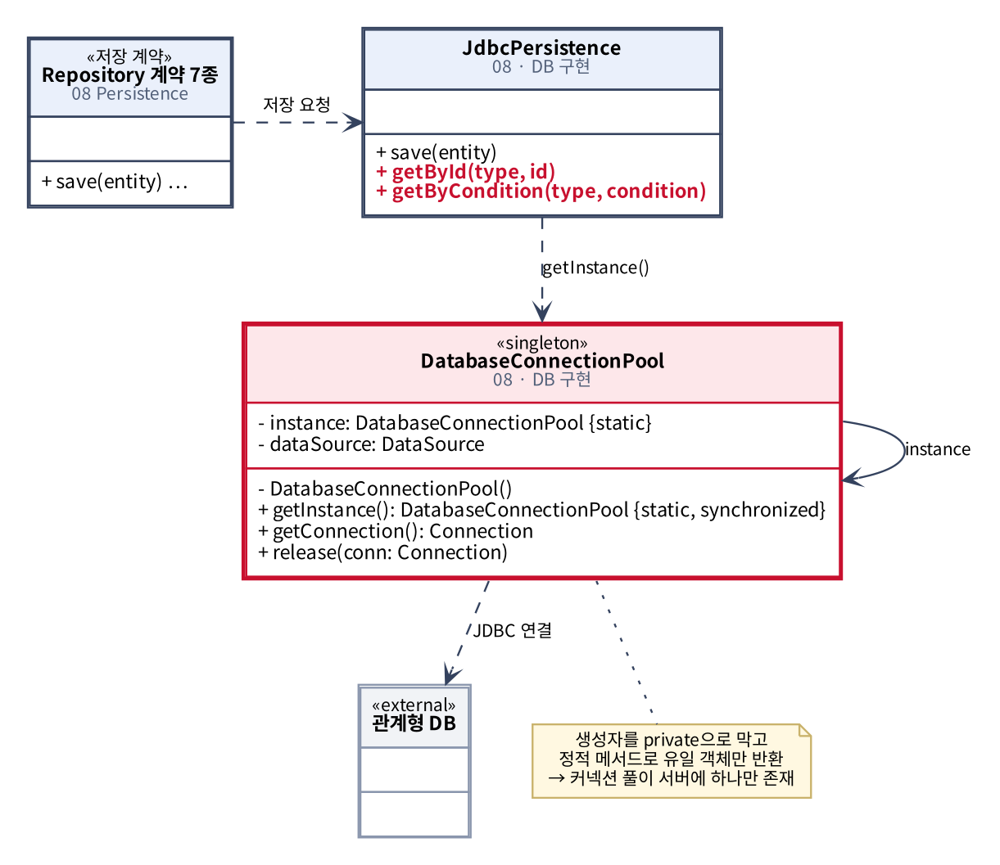
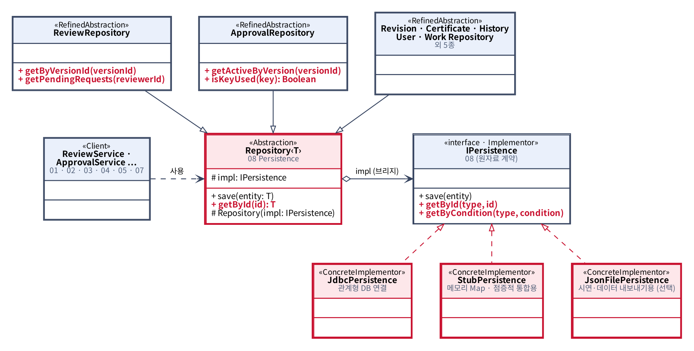
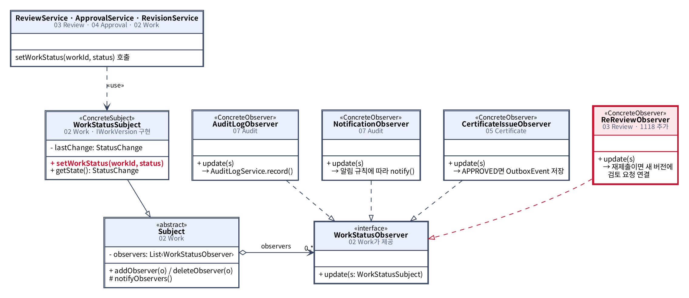
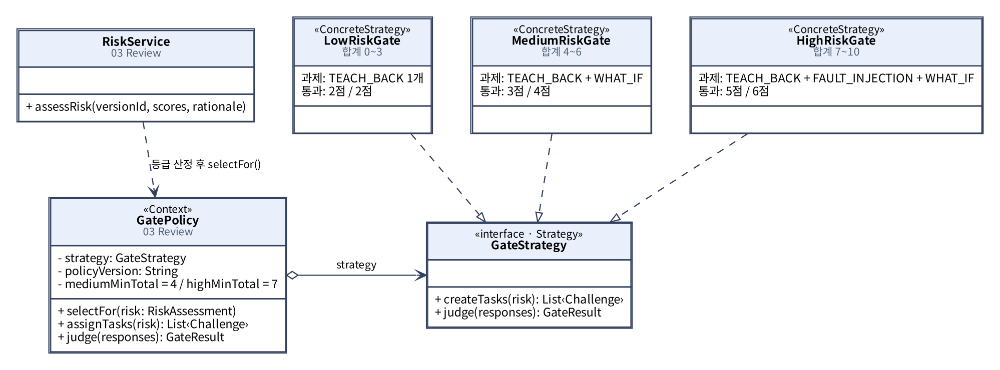

# HAVE 디자인(설계) 패턴 적용 분석 (v2)

소프트웨어공학 팀 프로젝트 · HAVE — AI·인간 협업 결과물 승인 증명 시스템 · 검토한 패턴 6개(싱글톤 · 어댑터 · 브리지 · 추상 팩토리 · 옵서버 · 전략) 가운데 싱글톤 · 브리지 · 옵서버 · 전략 4개 적용

분석 기준: Lecture #7 설계 원리 part1·part2 — CHAPTER 03 디자인 패턴 · 작성 2026-11-09 · 수정 2026-11-18(v2), 2026-11-23(오퍼레이션 명명 규칙 반영, 패턴 정리)

> **v2에서 바뀐 것**
>
> - 11-18: 7~10장을 후속 단계(HCI 프로토타입, DB 설계, 통합 상태 다이어그램)에 맞춰 다시 썼다. 작업 상태 값, 등급별 이해 과제와 통과 기준, 알림 규칙, 재검토 연결(ReReviewObserver), UserRepository·WorkRepository 추가.
> - 11-23: 오퍼레이션 이름을 강의의 명명 규칙에 맞췄다(조건 체크 is · 속성 읽기·탐색 get · 속성 쓰기 set). 바뀐 이름은 아래 표와 같고, 그림에서는 빨간 굵은 글자로 표시했다. 1~6장도 원문 쪽을 붙이지 않고 같은 내용으로 다시 조판했다. 
> - 11-23 패턴 정리: 강의 기준으로 다시 검토해 **어댑터와 추상 팩토리는 적용하지 않기로 했다**(4장 · 6장). 적용 패턴은 싱글톤 · 브리지 · 옵서버 · 전략 4개다. 타입 6개를 빼고 `StorageFileStoreAdapter`를 `StorageFileStore`로 바꿨다(9.2). 그림 2-1을 다시 그렸고 그림 4-1 · 4-2 · 6-1은 없앴다. 사용자 기능(UC01~UC10)과 저장 데이터는 달라지지 않는다.
> - 11-23 보강: 싱글톤 · 브리지 장에 "선택한 이유"를 더해 네 패턴의 칸 구성(해결하는 문제 · 선택한 이유 · 솔루션 · 예제 · 결과와 주의점)을 맞췄다.
> - 11-23 팀원 피드백 반영(7장): 옵서버는 상태를 바꾼 서비스의 트랜잭션 안에서 동기로 실행된다는 점과 실패 시 롤백을 명시했다(UC06 승인과 발급 요청을 한 트랜잭션에). 재제출 때 근거자료·AI 사용 신고가 바뀌면 새 버전이 CHALLENGE_PENDING에서 시작하도록 7.4 표와 NotificationObserver · ReReviewObserver 예제를 고쳤다. 승인 철회와 후속 버전은 동시에 성립하므로 "이전 버전 승인"을 승인 효력에서 빼고 최신 버전 여부로 따로 표시한다.

| 1109 원문의 이름 | v2의 이름 | 유형 |
| --- | --- | --- |
| `IWorkVersion.updateWorkStatus(workId, status)` | `setWorkStatus(workId, status)` | 속성 쓰기 |
| `IPersistence.findById(type, id)`, `findBy(type, condition)` | `getById(type, id)`, `getByCondition(type, condition)` | 탐색 |
| `Repository.findById(id)` · `findByVersionId` · `findPendingByReviewer` · `findActiveByVersion` | `getById(id)` · `getByVersionId` · `getPendingRequests` · `getActiveByVersion` | 탐색 |
| `ApprovalRepository.existsByKey(key)` | `isKeyUsed(key)` | 조건 체크 |
| `NotificationGateway.toMessage(type, targetId)`, `resolveAddress(userId)` | `getMessage(type, targetId)`, `getAddress(userId)` | 속성 읽기 |

예제 코드의 접근자도 같은 규칙으로 썼다(`file.getBytes()`, `c.getTo()`, `risk.getTotal()` 등). `save`, `put`, `notify`, `update`, `createTasks`, `judge`처럼 일을 하는 오퍼레이션(조작)은 강의 예제의 `makeOrder()`처럼 동사로 시작한다.

## 1. 개요

### 1.1 목적

강의에서 다룬 디자인(설계) 패턴을 HAVE 설계 자료에 하나씩 대입해, 해당 패턴이 적용될 자리가 있는지 판정하고 적용 방법을 구체적으로 정리한다. 강의 정의대로 디자인 패턴은 아키텍처 설계보다 낮은 수준의 설계 문제에 대한 재사용 가능한 솔루션이므로, 서브시스템 사이의 구조가 아니라 서브시스템 내부의 클래스·인터페이스 수준에서 적용 위치를 찾는다.

### 1.2 분석 범위

강의 part2의 CHAPTER 03 디자인 패턴에 나온 6개 패턴(싱글톤, 어댑터, 브리지, 추상 팩토리, 옵서버, 전략)을 모두 검토했다. part1의 CHAPTER 02 아키텍처 스타일(클라이언트–서버, 계층형, 이벤트 기반, MVC, 파이프 필터, 데이터 중심, P2P, 마이크로 커널, 브로커)은 「HAVE 서브시스템 정의와 구조유형 설계」 문서에서 다루었으므로 이 문서에서는 디자인 패턴과의 관계를 설명할 때만 언급한다.

### 1.3 근거 자료

| 자료 | 이 문서에서 사용한 내용 |
| --- | --- |
| HAVE 서브시스템 통합 정의서 | 8개 서브시스템의 책임·기능, 알림 규칙(검토 요청→검토자, 보완 요청→작성자, 재제출·검토 통과→검토자·승인자) |
| HAVE 구조유형 설계 | Service Layer + Domain Model + Repository 구조, Transactional Outbox·멱등성 키 보완 제안 |
| 패키지 다이어그램 레벨 2·3 | 서버 타입과 패키지 소속(1109 원자료 53개), 패키지 간 의존 방향 |
| 컴포넌트 다이어그램 | 제공·요구 인터페이스와 오퍼레이션(IWorkVersion, IPersistence, FileStore, INotification 등), 외부 연계(알림 채널·JDBC·IStorageAPI). 1109 기준 15종, v2 기준 17종 |
| 통합 상태 다이어그램 (1118) | 작업 버전의 상태(DRAFT · SUBMITTED · CHALLENGE_PENDING · REVIEW_PENDING · IN_REVIEW · REVISION_REQUIRED · APPROVAL_PENDING · APPROVED)와 전이. 승인 철회는 승인 효력으로 분리(후속 버전 여부는 효력이 아니라 최신 버전 여부로 따로 표시, 11-23). 위험 분석 뒤 "등급별 이해 과제 정책 선택" |
| Lecture #7 part1·part2 | 패턴 정의, 해결 방법, 강의 예제(DB 커넥션 싱글톤, 프린터 어댑터, Stub/XML/JDBC 브리지, 음악 재생 추상 팩토리, 뉴스 옵서버, 네트워크 전략) |

### 1.4 서술 형식과 표기

강의의 「디자인 패턴의 형식」(패턴 이름 · 소개 · 해결하는 문제 · 솔루션 · 예제 · 관련 패턴)을 그대로 따르고, 과제가 요구하는 "선택한 이유"를 해결하는 문제 다음에 둔다. 강의 p.8 표의 칸(이름 · 문제 · 해결책 · 결과)으로 보면 해결하는 문제 = 문제, 솔루션 = 해결책, 결과와 주의점 = 결과다. 발표 자료(pptx)의 패턴 쪽은 이 네 칸(문제 · 해결책 · 결과 · 선택한 이유)만 싣고 예제 코드는 넣지 않는다. 예제 코드는 컴포넌트 다이어그램의 JDBC 표기를 근거로 Java로 작성했으며, 설명용 골격이므로 예외 처리 등은 생략했다.

그림의 표기: 파란 머리 = 원자료에 있는 타입, 빨간 테두리 = 이 문서에서 추가 제안하는 타입, 회색 = 외부 시스템, 빨간 굵은 글자 = 11-23에 이름을 바꾼 오퍼레이션.

적용 구분: **원자료 구조 대응** = 원자료에 이미 패턴 형태의 구조가 있어 이를 패턴으로 정리 · **대응 + 보완** = 구조의 일부가 있고 나머지를 보완 · **보완 제안** = 원자료에 없는 타입을 새로 도입 · **검토 — 적용하지 않음** = 대입해 보았으나 적용 조건에 맞지 않아 쓰지 않음.

## 2. 적용 결과 요약

강의의 6개 디자인 패턴을 모두 HAVE에 대입해 보았고, 그 가운데 **4개(싱글톤 · 브리지 · 옵서버 · 전략)를 적용한다.** 브리지·전략은 원자료에 이미 같은 형태의 구조(Repository 계약과 IPersistence, GatePolicy)가 있어 패턴 이름으로 정리하는 성격이고, 옵서버는 알림 규칙과 상태 변경 오퍼레이션을 묶어 구조를 완성하는 보완이다. 싱글톤은 원자료에 없는 타입을 추가하는 제안이다. 어댑터와 추상 팩토리는 적용 조건에 맞지 않아 쓰지 않는다.

| 패턴 | HAVE 적용 위치 | 해결하는 문제 | 원자료 근거 | 구분 |
| --- | --- | --- | --- | --- |
| 싱글톤 | 08 Persistence · DB 구현의 DatabaseConnectionPool | 요청마다 DB 연결을 새로 만들거나 풀이 여러 개 생겨 연결이 고갈되는 문제 | 외부 관계형 DB(JDBC) 연계, 강의 예제(DB 커넥션) | 보완 제안 |
| 브리지 | 08 Repository 계약 7종 ↔ IPersistence 구현(JDBC·Stub·JSON 파일) | 저장 기술이 바뀌거나 DB 구현 완성 전에도 각 모듈이 개발·테스트되어야 함(점증적 통합) | ReviewRepository 등 5종, IPersistence(save · getById · getByCondition) | 원자료 구조 대응 |
| 옵서버 | 02 WorkStatusSubject → 07 이력·알림, 05 증명서 발급, 03 재검토 연결 | 상태가 바뀔 때마다 각 서비스가 이력 기록·알림·발급을 직접 호출해 중복·누락 발생 | 정의서 알림 규칙, IWorkVersion.setWorkStatus, IAuditLog·INotification, OutboxEvent | 대응 + 보완 |
| 전략 | 03 GatePolicy + GateStrategy 구현 3종 | 위험 등급에 따라 이해 과제 출제·판정 방식을 런타임에 바꿔야 함 | GatePolicy, 상태 다이어그램 "등급별 이해 과제 정책 선택", TEACH_BACK · FAULT_INJECTION · WHAT_IF | 원자료 구조 대응 |
| 어댑터 | (검토한 자리: 08 파일 저장, 07 알림 발송) | 맞춰야 할 기존(레거시) 클래스가 없다. 계약과 구현을 모두 새로 만든다 | 4장 | **검토 — 적용하지 않음** |
| 추상 팩토리 | (검토한 자리: 서버 조립 지점) | 환경에 따라 갈리는 제품이 IPersistence 구현 한 종류뿐이라 짝 맞출 패밀리가 없다 | 6장 | **검토 — 적용하지 않음** |



그림 2-1. 서브시스템별 디자인 패턴 배치(11-23 다시 그림). 검은 점선 화살표는 레벨 2 패키지 다이어그램의 의존 방향(의존 → 제공)이며, 빨간 점선은 옵서버로 생기는 통지 경로다. 서버 조립 지점은 패턴이 아니라 옵서버를 등록하고 저장소 구현을 고르는 자리다.

## 3. 싱글톤 패턴 (보완 제안)

> 강의 정의 — 객체를 강제적으로 하나만 생성하려는 목적(예: DB 커넥션을 위한 인터페이스). 방법: 클래스 자체를 정적 변수로, 생성자는 private, 유일한 객체를 접근하는 정적 메서드.

### 소개 — 어디에 적용하는가

08 데이터 저장(Persistence)의 DB 구현 내부에 JDBC 연결을 관리하는 `DatabaseConnectionPool`을 두고 싱글톤으로 만든다. 컴포넌트 다이어그램에서 08은 저장 계약을 구현하며 외부 관계형 DB와 JDBC로 연결되지만, 연결을 누가 몇 개 만드는지는 정해져 있지 않다. 강의 예제가 바로 DB 커넥션이므로 가장 직접적인 적용 위치다.

### 해결하는 문제

- 08의 IPersistence는 01·02·03·04·05·07 여섯 개 서브시스템이 사용한다. 각 Repository나 요청마다 연결을 새로 열면 연결 생성 비용이 커지고 DB 최대 연결 수를 넘길 수 있다.
- Repository 7종(Review · Revision · Approval · Certificate · History · User · Work)이 각자 커넥션 풀을 만들면 풀이 여러 개가 되어 전체 연결 수를 통제할 수 없다.

### 선택한 이유

강의 예제(DB 커넥션)와 같은 문제라 가장 직접적인 적용 위치다. 싱글톤은 전역 상태를 만들기 때문에, DB 연결처럼 외부 자원을 직접 소유하는 곳 하나에만 쓴다.

### 솔루션

| 강의 요소 | HAVE 대응 |
| --- | --- |
| 클래스 자체를 정적 변수로 | `private static DatabaseConnectionPool instance` |
| 생성자는 private | `private DatabaseConnectionPool()` — 설정(JDBC URL, 계정, 최대 연결 수)을 읽어 풀을 한 번만 구성 |
| 유일한 객체를 접근하는 정적 메서드 | `getInstance()` — JdbcPersistence가 호출해 연결을 빌림 |



그림 3-1. 싱글톤 적용 — 모든 Repository의 저장 요청은 JdbcPersistence를 거쳐 하나뿐인 커넥션 풀을 사용한다.

### 예제

```java
// 08 Persistence · DB 구현 (강의 DatabaseConnection 예제와 같은 구조)
public class DatabaseConnectionPool {
    private static DatabaseConnectionPool instance = null;
    private final DataSource dataSource;

    private DatabaseConnectionPool() {
        this.dataSource = createDataSource();   // JDBC URL·계정·최대 연결 수로 풀 구성
    }

    public static synchronized DatabaseConnectionPool getInstance() {
        if (instance == null) {
            instance = new DatabaseConnectionPool();
        }
        return instance;
    }

    public Connection getConnection() throws SQLException {
        return dataSource.getConnection();      // 풀에서 연결을 빌려 줌
    }
}

public class JdbcPersistence implements IPersistence {
    public void save(Object entity) {
        try (Connection c = DatabaseConnectionPool.getInstance().getConnection()) {
            // INSERT 또는 UPDATE 수행 — close() 시 연결이 풀로 반환됨
        }
    }
}
```

### 결과와 주의점

- "연결 1개"가 아니라 "풀 1개"를 싱글톤으로 한다. 강의 예제처럼 연결 하나를 모든 요청이 공유하면 동시 요청이 그 연결에서 줄을 서는 병목이 생긴다(클라이언트–서버 스타일의 단점으로 강의에서 언급한 '병목'과 같은 문제).
- 싱글톤은 전역 상태이므로 테스트에서 바꿔 끼우기 어렵다. 서비스·Repository 클래스까지 싱글톤으로 만들지 않고, 외부 자원을 직접 소유하는 커넥션 풀에만 적용한다. 테스트에서는 서버 조립 지점(`HaveServerBootstrap`)이 설정에 따라 `StubPersistence`를 넣어 풀 자체를 쓰지 않게 한다.
- Spring 같은 프레임워크를 쓰면 DataSource 빈이 기본적으로 하나만 만들어지므로, 같은 효과를 프레임워크가 대신 보장한다.

관련 패턴 — 브리지(`JdbcPersistence`가 브리지의 구현 쪽).

## 4. 어댑터 패턴 (검토 — 적용하지 않음)

> 강의 정의 — 사용 가능한 서비스의 인터페이스를 클라이언트가 예상하는 인터페이스에 맞게 조정. 어댑터는 ClientInterface를 구현하고, 요청을 LegacyClass에 위임하며 필요한 변환을 수행. 결과: Client와 LegacyClass는 수정되지 않고 서로 협력.

### 검토한 자리

강의 정의에 가장 가까운 자리는 두 곳이었다. 1109 판은 이 두 곳을 어댑터로 정리했다.

| 자리 | 클라이언트가 기대하는 계약 | 바깥 시스템 |
| --- | --- | --- |
| 08 파일 저장 | `FileStore.put(key, file)` · `get(key)` · `delete(key)` | 파일 저장소(IStorageAPI) |
| 07 알림 발송 | `INotification.notify(userId, type, targetId)` | 알림 채널(INotifyChannel: 이메일 · 브라우저 알림) |

### 적용하지 않는 이유

- 강의의 어댑터는 이미 있어서 고칠 수 없는 클래스(LegacyClass)를 클라이언트가 기대하는 인터페이스에 맞출 때 쓴다. 강의가 적은 결과도 "Client와 LegacyClass는 수정되지 않고 서로 협력"이다. HAVE는 새로 만드는 시스템이라 맞춰야 할 기존 클래스가 없다.
- `FileStore`와 `INotification`은 우리가 정한 계약이고 그 구현 클래스도 우리가 만든다. 계약을 구현하는 클래스 안에서 바깥 시스템을 부르면 되고, 이것은 인터페이스와 구현(실현 관계)이다.
- 그래서 11-23에 강의 기준으로 다시 검토하면서 어댑터를 뺐다.

### 대신 이렇게 한다

| 자리 | 처리 |
| --- | --- |
| 08 파일 저장 | `StorageFileStore`가 `FileStore`를 구현해 결과물·근거 파일을 파일 저장소에 저장한다. 1109의 `StorageFileStoreAdapter`에서 이름만 바꿨고 하는 일은 같다 |
| 07 알림 발송 | 원자료 클래스 `NotificationGateway`가 `INotification`을 구현한다. `getAddress(userId)`로 수신 주소를, `getMessage(type, targetId)`로 제목·본문을 만들어 알림 채널로 보내고 알림함(Notification)에 남긴다. 채널 구현 클래스(`EmailNotifyChannel`, `ConsoleNotifyChannel`)는 따로 두지 않는다 |

"승인된 버전의 파일은 변경하지 않는다" 같은 업무 판단은 지금처럼 서비스·도메인 모델에 둔다. 7장 옵서버의 NotificationObserver는 NotificationGateway를 그대로 쓴다.

## 5. 브리지 패턴 (원자료 구조 대응)

> 강의 정의 — 적용: 점증적으로 통합되는 서브시스템, 완성되기 전에는 스텁(stub) 사용, 서브시스템을 여러 버전(구현체)으로 만들어야 하는 경우. 해결: 추상화(인터페이스)와 구현을 분리해 독립적으로 변경, Stub / XML / JDBC 등 여러 구현을 상황에 맞게 갈아 끼움.

### 소개 — 어디에 적용하는가

08 Persistence에는 두 종류의 계약이 함께 있다. 업무 의미를 가진 Repository 계약(원자료 5종: Review · Revision · Approval · Certificate · History, 1118에 User · Work 추가)과, 타입과 조건만 받는 범용 IPersistence(`save` · `getById` · `getByCondition`)다. 원자료에서는 두 계약의 관계가 정해져 있지 않은데, 브리지 패턴으로 보면 Repository가 추상화(Abstraction), IPersistence가 구현(Implementor)이 되어 역할이 명확해진다.

### 해결하는 문제

- 점증적 통합: 팀원별로 02~07을 나누어 개발하면 08의 DB 구현이 완성되기 전에는 Review·Approval 기능을 실행해 볼 수 없다. 강의가 말한 "완성되기 전에는 스텁 사용"이 필요한 상황이다.
- 두 방향의 변화: Repository는 업무가 늘면 오퍼레이션이 늘고(예: 검토자별 대기 목록), 저장 기술은 JDBC·스텁·파일 등으로 바뀐다. 상속만으로 조합하면 Repository 7종 × 구현 3종 = 21개 클래스가 필요하지만, 브리지로 분리하면 7 + 3 = 10개로 끝난다.

### 선택한 이유

강의의 적용 조건과 맞는다. 브리지는 점진적 개발에서 구현이 완성되기 전에 스텁으로 대신할 때 쓴다(Ch07 part2 p.10, p.14 주석 "브리지는 점진적 개발 경우에만 적용"). HAVE는 4명이 서브시스템을 나눠 개발하고 단계적으로 합치며(구조유형 문서 P5), 원자료에 이미 Repository 계약과 IPersistence가 있어 둘의 관계만 정하면 된다.

### 솔루션

| 브리지 요소 | HAVE 대응 | 역할 |
| --- | --- | --- |
| Abstraction | `Repository<T>` (추가) | 공통 `save` · `getById`를 제공하고 IPersistence `impl`을 참조(브리지) |
| RefinedAbstraction | ReviewRepository 등 7종 | 업무 질의(`getByVersionId`, `isKeyUsed` 등)를 `impl` 호출로 표현 |
| Implementor | IPersistence (원자료) | 저장 기술과 무관한 기본 연산 3개 |
| ConcreteImplementor | JdbcPersistence · StubPersistence · JsonFilePersistence(선택) | 강의의 JDBC / Stub / XML 구현에 대응 |



그림 5-1. 브리지 적용 — 왼쪽(업무 질의)과 오른쪽(저장 기술)이 독립적으로 확장된다.

### 예제

```java
public abstract class Repository<T> {
    protected final IPersistence impl;                  // 추상과 구현을 잇는 다리
    protected Repository(IPersistence impl) { this.impl = impl; }
    public void save(T entity) { impl.save(entity); }
}

public class ReviewRepository extends Repository<Review> {
    public ReviewRepository(IPersistence impl) { super(impl); }
    public List<Review> getByVersionId(String versionId) {
        return impl.getByCondition(Review.class, Condition.eq("versionId", versionId));
    }
}

// 점증적 통합 1단계: DB 구현 완성 전, 검토 기능을 스텁으로 먼저 테스트
ReviewRepository repo = new ReviewRepository(new StubPersistence());
// 통합 단계: ReviewRepository·ReviewService 코드는 그대로, 구현만 교체
ReviewRepository repo = new ReviewRepository(new JdbcPersistence());
```

### 결과와 주의점

- 원자료에서 IPersistence를 01·02·03·04·05·07이 직접 사용한다고 되어 있는데, 브리지를 적용하면 **업무 서비스는 Repository를 사용하고, IPersistence는 Repository 안쪽에서만 사용**하도록 정리할 수 있다. 구조유형 설계의 "업무 서비스는 저장 계약을 사용한다"는 원칙과도 맞는다. Repository가 없던 모듈(01 Auth, 02 Work)에는 UserRepository · WorkRepository를 추가했다(9.2).
- `StubPersistence`는 메모리 Map으로 구현하므로 서버를 재시작하면 데이터가 사라진다. 개발·단위 테스트 전용이다.

관련 패턴 — 전략 패턴과 구조가 비슷하지만 전략은 "행위(알고리즘)"를, 브리지는 "구현 플랫폼"을 교체한다. 어떤 구현을 쓸지는 서버 조립 지점(`HaveServerBootstrap`)이 설정값으로 정한다. `JdbcPersistence`는 3장의 싱글톤 커넥션 풀을 쓴다.

## 6. 추상 팩토리 패턴 (검토 — 적용하지 않음)

> 강의 정의 — 객체를 사용할 클라이언트에서 구체적인 객체 생성을 지정하는 책임을 분리하기 위하여 추상 인터페이스를 이용해 관련 객체 패밀리를 생성. 강의 사례: AnalogMusicFactory / DigitalMusicFactory가 각각 Player와 Media를 짝 맞춰 생성. "유사한 클래스가 있는지 클래스 다이어그램을 보고 체크."

### 검토한 자리

강의의 조언대로 클래스 다이어그램에서 유사한 클래스 묶음을 찾았다. 1109 판은 저장·파일·알림 구현체가 실행 환경(운영 / 개발·테스트)에 따라 짝을 이룬다고 보고, 서버 조립 지점에 `InfrastructureFactory`와 구체 팩토리 둘을 두었다.

### 적용하지 않는 이유

- 추상 팩토리는 여러 종류의 제품을 같은 계열로 짝 맞춰 만들 때 쓴다(강의 사례의 Player와 Media). 4장에서 어댑터를 빼면서 테스트용 파일 저장과 알림 채널 구현이 없어졌고, 환경에 따라 갈리는 것은 IPersistence 구현 하나만 남았다. 제품이 한 종류면 짝 맞출 패밀리가 없다.
- 그 묶음은 요구사항에서 나온 것이 아니라 패턴을 적용하면서 생긴 구현체들이었다.
- 빼도 UC01~UC10의 흐름과 저장 데이터는 달라지지 않는다. 없어지는 것은 테스트용 구현 묶음을 한 번에 바꾸는 개발 편의다. DB 없이 시험하는 `StubPersistence`는 5장 브리지에 남는다.

### 대신 이렇게 한다

서버 조립 지점 `HaveServerBootstrap.start(profile)`이 두 가지를 한다. 설정값(profile)에 따라 `JdbcPersistence` 또는 `StubPersistence` 하나를 만들어 Repository에 넣고, 옵서버 4종을 WorkStatusSubject에 등록한다. 구현체 이름은 이 한 곳에만 나타난다.

| 뺀 타입 | 1109 판의 역할 | 빼도 되는 이유 |
| --- | --- | --- |
| InfrastructureFactory, ProductionInfraFactory, LocalStubInfraFactory | 추상 팩토리와 구체 팩토리 | 고를 것이 IPersistence 구현 하나뿐이라 HaveServerBootstrap이 직접 고른다 |
| InMemoryFileStore | 테스트용 파일 저장 | 테스트 묶음에만 쓰던 부품 |
| ConsoleNotifyChannel | 테스트용 알림(로그 출력) | 테스트 묶음에만 쓰던 부품 |
| EmailNotifyChannel | 이메일 발송 | 발송은 NotificationGateway가 맡는다(4장) |

조립 지점은 8개 업무 서브시스템 밖(서버 구성 영역)에 둔다.

## 7. 옵서버 패턴 (대응 + 보완)

> 강의 정의 — 데이터를 보관하는 Subject가 그 데이터를 이용하는 옵서버와 효과적으로 통신하면서 느슨하게 결합. Subject는 옵서버 목록을 유지하고 변경을 고지, Observer는 변경을 통지 받고 접근을 요청.

### 소개 — 어디에 적용하는가

HAVE의 핵심은 작업 버전의 상태 변화(작성 중 → 제출 완료 → 이해 확인 대기 → 검토 대기 → 검토 중 → 수정 요청 / 승인 대기 → 승인 완료)이고, 상태가 바뀔 때마다 여러 후속 처리가 따라온다. 상태 변경 지점은 `IWorkVersion.setWorkStatus(workId, status)` 한 곳이다. 이 지점을 Subject로, 이력·알림·발급 요청·재검토 연결을 Observer로 둔다.

### 해결하는 문제

- ReviewService, ApprovalService 등이 상태를 바꾼 뒤 `record()`와 `notify()`를 각자 직접 부르면 같은 코드가 여러 서비스에 반복되고, 한 곳에서 빠뜨리면 이력·알림이 누락된다(UC09 이력의 신뢰성 문제).
- 승인 후 증명서 자동 발급처럼 새 후속 처리를 넣을 때마다 ApprovalService를 고쳐야 한다.
- (1118 추가) 수정본 재제출 때 02 Work가 03 Review의 재검토 요청을 직접 부르면 02 → 03 의존이 생겨 기존 03 → 02 의존과 순환한다.

### 선택한 이유

상태 변경 한 번에 반응해야 하는 쪽이 넷(이력, 알림, 발급, 재검토)이고 앞으로 늘 수 있다. 옵서버는 Subject와 기존 서비스를 고치지 않고 반응을 더할 수 있고, 02가 인터페이스만 정의하므로 의존 방향이 한쪽(03·05·07 → 02)으로 정리된다.

### 솔루션

| 강의 요소 | HAVE 대응 | 역할 |
| --- | --- | --- |
| Subject | Subject (02 Work) | 옵서버 목록 유지, addObserver · deleteObserver · notifyObservers |
| ConcreteSubject | WorkStatusSubject (02 Work) | setWorkStatus 구현, getState()로 변경 내용(StatusChange) 제공 |
| Observer | WorkStatusObserver (02가 제공하는 인터페이스) | update(subject) |
| ConcreteObserver | AuditLogObserver (07), NotificationObserver (07), CertificateIssueObserver (05), **ReReviewObserver (03 · 1118 추가)** | 이력 기록 / 규칙에 따른 알림 / 승인 시 발급 이벤트 저장 / 재제출 시 새 버전에 검토 요청 연결 |



그림 7-1. 옵서버 적용. 빨간 테두리가 1118에서 더한 옵서버, 빨간 굵은 글자가 11-23에 이름을 바꾼 오퍼레이션이다.

### 상태 전이별 옵서버 반응

통합 상태 다이어그램 ①의 전이와 `HAVE_용어_상태_통일표` 6절의 알림 규칙을 그대로 옮겼다.

| 상태 전이 (setWorkStatus) | AuditLogObserver | NotificationObserver | 그 밖의 옵서버 |
| --- | --- | --- | --- |
| DRAFT → SUBMITTED (버전 등록) | 이벤트 기록 | — | — |
| SUBMITTED → CHALLENGE_PENDING (검토 요청) | 이벤트 기록 | 검토자: 검토 요청 | — |
| CHALLENGE_PENDING → REVIEW_PENDING (답변 제출) | 이벤트 기록 | 검토자: 답변 제출 (재제출로 생긴 버전이면 "재제출") | — |
| CHALLENGE_PENDING · REVIEW_PENDING → SUBMITTED (요청 취소) | 이벤트·사유 기록 | 검토자: 요청 취소 | — |
| REVIEW_PENDING → IN_REVIEW (검토 시작) | 이벤트 기록 | — | — |
| IN_REVIEW → APPROVAL_PENDING (검토 통과) | 이벤트 기록 | 최종 승인자·작성자: 검토 통과 | — |
| IN_REVIEW → REVISION_REQUIRED (수정 요청) | 이벤트·사유 기록 | 작성자: 수정 요청 | — |
| APPROVAL_PENDING → APPROVED (최종 승인) | 이벤트 기록 | 작성자·검토자: 최종 승인 | CertificateIssueObserver: 승인과 같은 트랜잭션에서 OutboxEvent 저장 → 커밋 뒤 증명서 발급 |
| APPROVAL_PENDING → REVISION_REQUIRED (반려) | 이벤트·사유 기록 | 작성자·검토자: 반려 | — |
| 새 버전 생성 → REVIEW_PENDING (재제출 · 근거 그대로) | 이벤트 기록 | 검토자: 재제출 | ReReviewObserver: 검토 요청·위험 평가·과제·답변 사본 연결 |
| 새 버전 생성 → CHALLENGE_PENDING (재제출 · 근거 변경, 11-23) | 이벤트 기록 | — (답변 제출 뒤 검토자에게 "재제출") | ReReviewObserver: 검토 요청·위험 평가·과제 사본 연결, 답변은 비우고 이전 답변은 출처 버전과 함께 참고로 |

1109 문서가 남긴 문제 둘이 풀렸다. '검토 통과'는 별도 상태가 없어 옵서버로 알릴 수 없다고 했는데, 통합 상태 다이어그램에서 APPROVAL_PENDING(승인 대기)이 그 상태다. 승인 완료·철회 알림은 "팀에서 정하면"이라고 비워 두었는데 HCI 프로토타입이 대상을 정했다.

승인 철회(UC10)는 이 표에 없다. 철회는 작업 상태를 바꾸지 않고 승인 효력만 바꾸므로 `setWorkStatus`를 거치지 않는다. ApprovalService가 `IAuditLog.record()`와 `INotification.notify()`를 직접 부른다.

### 예제

```java
public abstract class Subject {
    private final List<WorkStatusObserver> observers = new ArrayList<>();
    public void addObserver(WorkStatusObserver o)    { observers.add(o); }
    public void deleteObserver(WorkStatusObserver o) { observers.remove(o); }
    protected void notifyObservers() {
        for (WorkStatusObserver o : observers) o.update((WorkStatusSubject) this);
    }
}

public class WorkStatusSubject extends Subject {     // IWorkVersion.setWorkStatus 구현을 담당
    private StatusChange lastChange;

    public void setWorkStatus(String workId, WorkStatus to) {
        WorkVersion v = versionService.getCurrentVersion(workId);
        lastChange = new StatusChange(workId, v.getId(), v.getStatus(), to, getCurrentActor());
        v.changeStatus(to);              // 전이 가능 여부는 도메인 모델이 검사
        notifyObservers();               // ① 모든 옵서버에게 통보
    }
    public StatusChange getState() { return lastChange; }
}

public class NotificationObserver implements WorkStatusObserver {   // 07 Audit
    public void update(WorkStatusSubject s) {
        StatusChange c = s.getState();
        switch (c.getTo()) {
            case CHALLENGE_PENDING -> { if (!c.isNewVersion())          // 재제출(근거 변경)로 생긴 버전은 답변 제출 뒤에 알린다
                                          gateway.notify(c.getReviewerId(), REVIEW_REQUESTED, c.getVersionId()); }
            case REVIEW_PENDING    -> gateway.notify(c.getReviewerId(),
                                          c.isResubmission() ? RESUBMITTED : ANSWERS_SUBMITTED, c.getVersionId());
            case REVISION_REQUIRED -> gateway.notify(c.getAuthorId(),
                                          c.getFrom() == APPROVAL_PENDING ? REJECTED : REVISION_REQUESTED, c.getVersionId());
            case APPROVAL_PENDING  -> { gateway.notify(c.getApproverId(), REVIEW_PASSED, c.getVersionId());
                                        gateway.notify(c.getAuthorId(),   REVIEW_PASSED, c.getVersionId()); }
            case APPROVED          -> { gateway.notify(c.getAuthorId(),   APPROVED, c.getVersionId());
                                        gateway.notify(c.getReviewerId(), APPROVED, c.getVersionId()); }
            default                -> { }
        }
    }
}

public class ReReviewObserver implements WorkStatusObserver {       // 03 Review · 1118 추가
    public void update(WorkStatusSubject s) {
        StatusChange c = s.getState();
        if (c.isNewVersion() && (c.getTo() == REVIEW_PENDING || c.getTo() == CHALLENGE_PENDING)) {   // UC05 재제출로 생긴 새 버전
            boolean keepAnswers = c.getTo() == REVIEW_PENDING;          // 근거 그대로면 답변도 사본, 바뀌면 참고로만 (11-23)
            reviewRequestService.linkReReview(c.getPreviousVersionId(), c.getVersionId(), keepAnswers);
        }
    }
}
```

### 결과와 주의점

- 03·04 서비스는 상태 변경만 하고 이력·알림 규칙은 07 한 곳에 모인다.
- 증명서 발급은 옵서버만으로는 안전하지 않다. CertificateIssueObserver는 직접 발급하지 않고 승인과 같은 트랜잭션에서 OutboxEvent만 저장하며, 실제 발급은 Outbox 처리기가 맡는다. 실패하면 `ICertificateAPI.retryIssue(certId)`로 다시 시도한다.
- (11-23 수정) 옵서버는 상태를 바꾼 서비스의 트랜잭션 안에서 동기로 실행되고, 하는 일은 같은 DB에 행을 저장하는 것(이력 · 알림 · OutboxEvent · 재검토 연결)뿐이다. 그래서 옵서버 하나라도 저장에 실패하면 상태 변경까지 함께 롤백한다. 예외를 삼키고 커밋하면 "승인은 됐는데 발급 요청이 없는" 상태가 생기기 때문이다. 알림 전송과 서명처럼 실패할 수 있는 바깥 일은 옵서버가 아니라 커밋 뒤의 처리기가 맡는다(UC06 순서 다이어그램의 critical 영역). 옵서버 실행 순서에 의존하는 로직은 만들지 않는다.

## 8. 전략 패턴 (원자료 구조 대응)

> 강의 정의 — 런타임에 알고리즘·동작 방식을 동적으로 교체해야 하는 경우. 동작을 인터페이스로 추상화하고 각 알고리즘을 별도 클래스로 구현, 객체를 바꿔 끼우는 것만으로 동작을 교체.

### 소개 — 어디에 적용하는가

03 검토 관리의 GatePolicy가 Context다. 위험 분석(UC03)에서 4개 지표 점수의 합(0~10)으로 등급을 정하면, 등급에 따라 이해 과제를 내는 방식과 통과 판정 기준이 달라진다.

### 해결하는 문제

- GatePolicy 안에 `if (등급 == 높음) {...} else if ...`로 모든 등급의 출제·판정을 넣으면 기준이나 과제 종류가 바뀔 때마다 큰 조건문을 고쳐야 하고 등급별 시험이 어렵다.
- 위험 평가 결과가 나와야 어떤 정책을 쓸지 알 수 있으므로 실행 중에 골라야 한다.

### 선택한 이유

바뀌는 것이 "과제를 내고 판정하는 알고리즘"이고 등급마다 구조는 같고 내용만 다르다. 전략으로 나누면 등급 하나를 고치거나 더할 때 클래스 하나만 건드린다.

### 솔루션

| 강의 요소 | HAVE 대응 | 역할 |
| --- | --- | --- |
| Context | GatePolicy | 위험 평가 결과로 전략을 골라 보관, 과제 배정·판정을 전략에 위임. 등급 경계(4, 7)는 DB의 GATE_POLICY에서 읽는다 |
| Strategy | GateStrategy | createTasks(risk), judge(responses) |
| ConcreteStrategy | LowRiskGate, MediumRiskGate, HighRiskGate | 등급별 과제 구성과 통과 기준 |
| 전략을 고르는 쪽 | RiskService | assessRisk()로 점수를 계산한 뒤 GatePolicy.selectFor() 호출 |



그림 8-1. 전략 적용.

| 등급 | 전략 | 과제 | 통과 기준 |
| --- | --- | --- | --- |
| LOW (합계 0~3) | LowRiskGate | TEACH_BACK 1개 | 2점 / 2점 |
| MEDIUM (합계 4~6) | MediumRiskGate | TEACH_BACK + WHAT_IF | 3점 / 4점 |
| HIGH (합계 7~10) | HighRiskGate | TEACH_BACK + FAULT_INJECTION + WHAT_IF | 5점 / 6점 |

검토자가 과제마다 0~2점을 매기고(UC04), 치명 오류가 하나라도 있으면 등급과 관계없이 통과할 수 없다.

1109 문서의 예제는 HighRiskGate를 "Teach-back + What-if 6문항, 5개 이상 정답"으로 썼다. 계획서의 "5/6"은 문항 수가 아니라 점수다(과제 3개 × 2점). UC06·10 다이어그램의 "3개 제출 · 5/6 이상"과 프로토타입이 이 해석과 같다. FAULT_INJECTION도 빠져 있었다.

### 예제

```java
public class HighRiskGate implements GateStrategy {
    public List<Challenge> createTasks(RiskAssessment risk) {
        return List.of(Challenge.of(TEACH_BACK), Challenge.of(FAULT_INJECTION), Challenge.of(WHAT_IF));
    }
    public GateResult judge(List<ChallengeResponse> rs) {
        int total = rs.stream().mapToInt(r -> r.getEvaluation().getScore()).sum();        // 과제당 0~2점
        boolean critical = rs.stream().anyMatch(r -> r.getEvaluation().isCritical());
        return (total >= 5 && !critical) ? GateResult.PASS : GateResult.FAIL;       // 5점 / 6점
    }
}

public class GatePolicy {                                   // Context
    private GateStrategy strategy;
    public void selectFor(RiskAssessment risk) {
        GatePolicyRow p = policies.getByVersion(risk.getPolicyVersion());   // GATE_POLICY: 4, 7
        int total = risk.getTotal();                              // 0~10
        if (total >= p.getHighMinTotal())        strategy = new HighRiskGate();
        else if (total >= p.getMediumMinTotal()) strategy = new MediumRiskGate();
        else                                     strategy = new LowRiskGate();
    }
    public List<Challenge> assignTasks(RiskAssessment r) { return strategy.createTasks(r); }
    public GateResult judge(List<ChallengeResponse> rs)  { return strategy.judge(rs); }
}
```

### 결과와 주의점

- 최종 승인 조건(검토 통과, 자기 승인 아님, 파일 해시 일치) 가운데 Gate 전략이 판정하는 것은 "과제 점수와 치명 오류"뿐이다. 자기 승인 금지와 해시 일치는 04 ApprovalService가 확인한다.
- 등급 경계 4·7은 계획서 17쪽과 DB의 GATE_POLICY로 확정됐다. LOW·MEDIUM의 통과 기준(2/2, 3/4)은 프로토타입이 제안한 값이라 팀 확인이 필요하다.
- 위험 점수 산정 방식을 바꿔 볼 가능성이 생기면 RiskScoringStrategy로 나눌 수 있다. 지금은 하나라 적용하지 않는다.

## 9. 패턴 간 관계와 추가 타입 목록

### 9.1 패턴 간 관계

| 묶음 | 참여 패턴 | 협력 방식 |
| --- | --- | --- |
| 저장 인프라 | 브리지 · 싱글톤 | Repository(브리지 추상)는 IPersistence 구현을 쓰고, JdbcPersistence는 싱글톤 커넥션 풀로 DB에 접속한다. 어떤 구현을 쓸지는 서버 조립 지점이 서버 시작 때 설정값으로 정한다 |
| 업무 흐름의 후속 처리 | 옵서버 | 상태 변경을 옵서버가 03·05·07로 전달한다. 알림은 NotificationGateway가 알림 채널로 보내고 알림함(Notification)에도 남긴다 |
| 검토 정책 | 전략 | 위험 평가 결과에 따라 Gate 전략을 바꾼다. 판정 결과가 상태 전이(IN_REVIEW → APPROVAL_PENDING / REVISION_REQUIRED)를 일으키면 옵서버 묶음으로 이어진다 |

### 9.2 추가·구체화되는 타입

1109의 24개에 1118에서 3개를 더했고, 11-23 패턴 정리로 6개를 빼 21개가 됐다(패턴 타입 19개 + 서버 조립 지점 1개 + 파일 저장 구현 1개). 모두 패키지 다이어그램 레벨 3 v2와 클래스 다이어그램 v3에 반영했다.

| 타입 | 패턴 | 소속 | 비고 |
| --- | --- | --- | --- |
| DatabaseConnectionPool | 싱글톤 | 08 · DB 구현 | 1109 |
| Repository‹T›, JdbcPersistence, StubPersistence, JsonFilePersistence(선택) | 브리지 | 08 | 1109 |
| **UserRepository, WorkRepository** | 브리지 (RefinedAbstraction) | 08 · 저장 계약 | **1118 추가** — 01 Auth, 02 Work도 Repository를 거쳐 저장 |
| Subject, WorkStatusSubject, WorkStatusObserver, StatusChange | 옵서버 | 02 Work | 1109 |
| AuditLogObserver, NotificationObserver | 옵서버 | 07 Audit | 1109 |
| CertificateIssueObserver | 옵서버 | 05 Certificate | 1109 |
| **ReReviewObserver** | 옵서버 (ConcreteObserver) | 03 Review | **1118 추가** — 재제출 시 재검토 연결 |
| GateStrategy, LowRiskGate, MediumRiskGate, HighRiskGate | 전략 | 03 Review | 1109 |
| HaveServerBootstrap | (패턴 아님) | 서버 조립 지점 | 1109. 11-23에 역할을 옵서버 등록 · 저장소 구현 선택으로 정리 |
| **StorageFileStore** | (패턴 아님 · FileStore 구현) | 08 · 파일 구현 | **11-23 이름 변경** ← StorageFileStoreAdapter |

11-23에 뺀 타입 6개: InfrastructureFactory, ProductionInfraFactory, LocalStubInfraFactory, InMemoryFileStore, EmailNotifyChannel, ConsoleNotifyChannel (4장 · 6장).

## 10. 의존 관계 변화와 확인 사항

### 10.1 패키지 의존 관계 변화

| 변화 | 내용 |
| --- | --- |
| 07 Audit → 02 Work | 07의 옵서버가 02의 WorkStatusObserver를 구현한다 |
| 05 Certificate → 02 Work | CertificateIssueObserver가 WorkStatusObserver를 구현한다 |
| 03 Review → 02 Work (1118 추가) | ReReviewObserver가 WorkStatusObserver를 구현한다. 03 → 02는 IWorkVersion 때문에 원래 있던 방향이라 새 의존은 아니다 |
| 업무 서비스 → IPersistence (축소) | 01~05·07의 서비스는 Repository만 쓰고 IPersistence는 Repository 안쪽에서만 쓴다 |
| 순환 의존 | 없다. 02는 옵서버 인터페이스만 정의하고 등록은 서버 조립 지점에서 한다 |

패키지 다이어그램 레벨 2 v2에 위 의존과 서버 조립 지점을 그렸다. 1109의 레벨 2·3에는 빠져 있었다.

### 10.2 1109의 확인 사항이 어떻게 됐는가

| 1109의 확인 사항 | 결과 |
| --- | --- |
| 1. 유스케이스 번호 불일치 (상태 다이어그램과 정의서) | 해소. 번호가 다르던 상태 다이어그램은 폐기됐고, 1118 통합 상태 다이어그램이 UC01~UC10 번호를 쓴다 |
| 2. '검토 통과'의 상태 표현 | 해소. APPROVAL_PENDING(승인 대기) |
| 3. 위험 등급 경계값과 등급별 과제 구성 | 경계 4·7 확정. 과제 구성과 HIGH 기준 확정. LOW·MEDIUM 통과 기준은 팀 확인 필요 |
| 4. Repository가 없는 모듈 | 해소. UserRepository, WorkRepository 추가 |
| 5. CertificateIssueObserver의 위치와 Outbox 재시도 | 위치는 05 유지. 재시도는 `ICertificateAPI.retryIssue`와 OUTBOX_EVENT.retry_count |
| 6. 구현 언어·프레임워크 | 미정. 서버 예제는 Java, 클라이언트는 크롬 확장 프로그램(JavaScript) |
