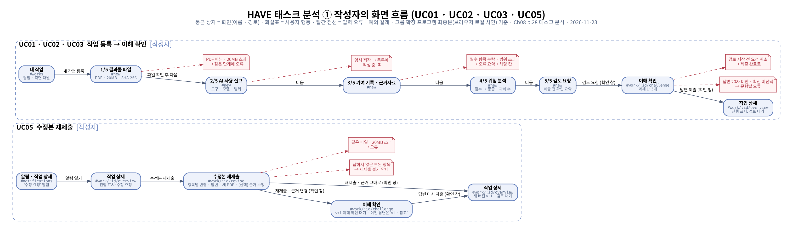
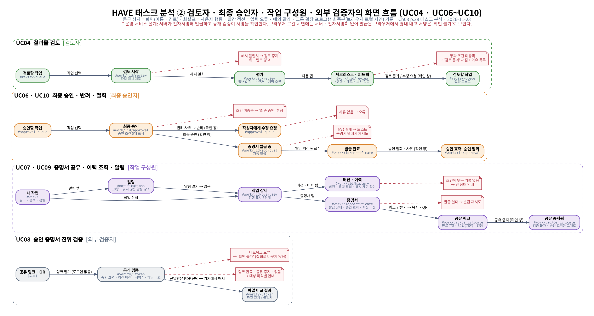

# HAVE HCI 보강 — 피드백 · 태스크 분석 · 입력 설계

2026-11-23 · 기준: 크롬 확장 프로그램 최종본(`have-chrome-extension`), `DESIGN.md`, 유스케이스 명세 · 수업 자료: Ch08 UI 설계(p.12 피드백, p.28 태스크 분석, p.43~46 입력 설계)

강의 Ch08의 세 항목을 확장 프로그램이 실제로 어떻게 처리하는지 정리했다. 구현에 이미 들어 있던 것을 설계 문서로 옮긴 것이고, 11-23 팀원 피드백으로 고친 두 가지(재제출 때 근거가 바뀌면 이해 확인을 다시 받음, 공개 검증에 승인 철회와 후속 버전을 함께 표시)는 확장 프로그램에도 반영했다.

> **화면 범위 — 브라우저 로컬 시연과 운영 서비스 설계 (11-23).** 이 문서의 화면과 문구는 크롬 확장 프로그램 최종본, 즉 **브라우저 로컬 시연**이다. 서버 · 로그인 · 전자서명이 없고 기록은 그 브라우저에만 저장된다. 서버 전자서명, 다른 기기에서 최신 승인 효력 조회, 계정 사이의 알림 전달은 **운영 서비스 설계**(구조유형 · 컴포넌트 · 배치 다이어그램)에 있고, 시연에서는 같은 브라우저 안에서 역할을 바꿔 흉내 낸다. 표와 그림에서 이 구분이 필요한 곳은 "시연" · "운영 서비스 설계"로 적었다.

| 강의 항목 | 주석 · 강조 | 이 문서 |
| --- | --- | --- |
| 피드백 (p.12) | "디자인에 반드시 포함" | 1절 |
| 태스크 분석 (p.28) | "유스케이스 별로 UI 흐름을 파악", 주석 "가시성, 사용자 편의성 등을 만족하면서도 업무 프로세스는 지켜서 아이콘 등을 어떻게 배치할 것인지" | 2절 |
| 입력 설계 (p.43~46) | 형광펜 "입력량 줄이기", "입력 오류를 줄이기 위한 체크", "효과적인 입력 제어 개발" | 3절 |

## 1. 피드백 — 사용자 지시에 대한 효과를 보여 준다

사용자는 명령이 어떻게 진행되는지, 입력이 어떻게 해석됐는지 궁금해한다(p.12). HAVE는 업무 단계가 길고(등록 → 이해 확인 → 검토 → 승인 → 증명서) 여러 사람을 거치므로, "지금 어디까지 왔고 다음은 누가 무엇을 하나"를 항상 보여 준다.

| 상황 | 피드백 방식 | 화면에 보이는 것 |
| --- | --- | --- |
| 작업이 지금 어디까지 왔나 | 진행 표시 5단계 | 작업 등록 → 이해 확인 → 사람의 검토 → 최종 승인 → 증명서. 현재 단계 강조, 수정 요청 · 반려는 따로 표시 |
| 다음에 무엇을 해야 하나 | 작업 머리 영역 | 작업명 / 대상 버전 / 현재 상태 / 다음 행동 문장 (예: "검토자 김지은 · 검토를 시작할 차례예요.") |
| 등록 마법사 진행 | 단계 표시 + 쪽 번호 | 1 결과물 파일 … 5 검토 요청, "3 / 5", 지난 단계는 완료 표시 |
| PDF를 고른 직후 (1~10초 걸림) | 진행 문구 (반응 시간 표시) | "파일을 확인하는 중…" → 파일 이름 · 크기 · SHA-256 표시 |
| 공개 검증에서 PDF 비교 | 진행 문구 → 결과 배지 | "파일의 SHA-256을 계산하고 있어요." → 파일 일치 / 파일 불일치 / 확인 불가 |
| 저장 · 제출 · 결정이 끝남 | 토스트 (잠시 뜨는 알림) | "답변을 제출했어요. 검토자의 확인을 기다려 주세요.", "검토를 요청했어요. 이해 확인을 진행해 주세요.", "증명서가 발급됐어요." 등 |
| 임시 저장 | 저장 시각 표시 | "임시 저장됨 · 14:05" |
| 되돌릴 수 없는 결정 직전 | 확인 창 | 답변 제출, 검토 통과 · 수정 요청, 최종 승인, 반려, 승인 철회, 재제출 — 대상(작업명 · 버전)과 결과를 적고 한 번 더 묻는다 |
| 근거를 바꿔 재제출함 (11-23) | 안내 + 화면 이동 | 재제출 화면에 "근거가 바뀌었어요 · 재제출하면 이해 확인 답변을 다시 받아요" 표시 → 이해 확인 화면으로 이동, 문항마다 "v1 답변 · 참고" |
| 증명서 발급 (비동기) | 상태 배지 + 토스트 | 발급 중 → 발급 완료 / 발급 실패 + "증명서 탭에서 다시 시도해 주세요" · 시연은 브라우저에서 발급을 흉내 내고 전자서명이 없다(서버 서명은 운영 서비스 설계) |
| 입력이 잘못됨 | 오류 요약 + 칸별 오류 | "입력 내용을 확인해 주세요" 상자와 해당 칸 아래 빨간 문장, 칸에 aria-invalid |
| 조건이 모자라 버튼을 누를 수 없음 | 버튼 끄기 + 이유 목록 | 검토 통과 · 최종 승인 버튼이 꺼지고, 모자란 조건을 목록으로 보여 준다 |
| 저장 실패 · 다른 창에서 먼저 고침 | 경고 띠 + 다시 시도 | "다시 저장" 버튼, "다른 창에서 이 버전이 바뀌었어요. 다시 열어 주세요." |
| 다른 사람의 행동 (요청 · 승인 등) | 알림 + 도구 모음 배지 | 알림 10종(읽음 표시), 확장 프로그램 아이콘에 "내 확인 필요" 건수 · 시연은 한 브라우저에서 역할을 바꿔 확인(계정 간 알림 전달은 운영 서비스 설계) |
| 화면 읽기 프로그램 사용자 | 음성 안내 영역 (aria-live) | "저장 완료", "파일 확인 완료", "활동 12건", "3개 작업" |

1~10초가 걸릴 수 있는 작업(파일 해시 계산, 증명서 발급)은 결과가 나올 때까지 진행 문구나 "발급 중" 상태를 보여 준다(p.12 "반응 시간의 표시"). 증명서 발급은 승인과 따로 처리해서, 발급에 실패해도 승인은 그대로 두고 재시도 버튼을 준다.

## 2. 태스크 분석 — 유스케이스별 화면 흐름

하위 작업 사이의 정보 흐름이 화면 흐름을 정한다(p.28). 유스케이스마다 사용자가 거치는 화면과 행동, 입력 오류 · 예외 갈래를 그렸다. 화면 이름과 경로는 확장 프로그램 최종본의 실제 화면이다.

그림 1. 작성자의 화면 흐름 (UC01 · UC02 · UC03 · UC05)

그림 2. 검토자 · 최종 승인자 · 작업 구성원 · 외부 검증자의 화면 흐름 (UC04 · UC06~UC10) — 11-23 최종 점검: UC07 공유 중지, UC09 해시 체인 확인 · 알림 탭 흐름을 더했다

업무 순서는 지키면서 화면을 편하게 하려고 정한 배치는 다음과 같다(p.28 주석).

- 역할별 입구를 나눴다. 작성자는 "내 작업", 검토자는 "검토할 작업", 최종 승인자는 "승인할 작업"에서 시작한다. 전체 탭의 왼쪽 메뉴와 측면 패널의 아래쪽 탭에 같은 순서로 아이콘과 함께 둔다.
- 순서가 정해진 입력은 5단계 마법사로 나눴다. 앞 단계를 통과해야 다음 단계로 가므로 업무 순서를 건너뛸 수 없다.
- 결정 버튼(검토 통과, 최종 승인)은 조건을 채우기 전까지 꺼 둔다. 업무 규칙을 화면이 먼저 지킨다.
- 팝업(360px)에는 지금 할 일과 바로가기만 두고, 긴 입력과 검토는 측면 패널(400px)이나 전체 탭에서 한다.
- (11-23) 수정본 재제출에서 근거자료 · AI 사용 신고를 바꾸면 재제출 뒤 이해 확인 화면으로 바로 이어진다. 이전 답변은 문항마다 출처 버전("v1 답변 · 참고")을 붙여 보여 주고, 답변은 새로 받는다. 근거를 바꾸지 않았으면 이전처럼 작업 상세(검토 대기)로 간다.
- (11-23) 그림 2의 "*" 표시는 운영 서비스 설계와 시연이 다른 곳이다. 운영에서는 서버가 전자서명해 발급하고 공개 검증이 서명을 확인하지만, 시연에서는 발급을 브라우저에서 흉내 내고 서명은 "확인 불가"로 보인다.

## 3. 입력 설계 — 입력량을 줄이고 오류를 미리 막는다

HAVE의 입력은 모두 온라인 입력이라 입력하는 즉시 검사한다(p.44).

### 3.1 입력량 줄이기 (p.44)

| 방법 | HAVE에서 |
| --- | --- |
| 계산할 수 있는 값은 입력받지 않는다 | 위험 등급 · 과제 수(점수 합계로 계산), SHA-256, 버전 번호, 승인 효력 · 최신 버전 여부, 재제출 때 근거 변경 여부, 기여 타임라인 |
| 상수 · 이미 있는 값은 다시 받지 않는다 | 새 버전 등록 때 작업명은 이전 값(읽기 전용). 검토자 · 최종 승인자는 지난 버전 값을 기본으로 |
| 선택 상자 · 라디오로 고르게 한다 | 위험 지표 4개(0~3 · 0~3 · 0~2 · 0~2), 기여 단계 · 수행 주체, 근거자료 유형, 확신 정도, AI 사용 여부, 검토자 · 최종 승인자, 답변 점수(0~2), 공유 링크 만료 |
| 코드를 쓴다 | 단계 · 수행 주체 · 유형 · 확신 정도는 화면에서는 한글로 고르고 저장은 코드 값(DB 부록 A) |
| 한 번의 선택이 다른 입력을 대신한다 | AI 미사용을 고르면 기여 기록의 수행 주체가 모두 "사람"이 되고 AI 사용 비중 점수가 0 |
| 파일 입력을 짧게 한다 | 끌어다 놓기, 현재 탭의 PDF 가져오기(팝업) |
| 기본값을 둔다 | 검토 기한 = 오늘 + 3일, 공유 링크 만료 = 30일 |

### 3.2 자료 입력 화면 체크리스트 (p.45)

| 체크 항목 | HAVE에서 |
| --- | --- |
| 접근 제한 | 지정 검토자 · 지정 최종 승인자만 해당 화면에서 결정할 수 있다. 작성자는 자기 결과물을 검토 · 승인할 수 없다 |
| 해설 제공 · 보기 예시 | 단계마다 안내 문장, 칸마다 "예: ChatGPT · GPT-4o" 같은 예시 글자, 이해 과제마다 질문 설명 |
| 항목의 끝 · 필수 표시 | 칸 이름 옆 "필수" / "선택", 기여 기록은 "한 건 이상" |
| 디폴트 값 · 콤보 박스 | 검토 기한 3일 뒤, 링크 만료 30일 / 선택 상자 9종 |
| 입력 중단과 취소 | 임시 저장, 저장하지 않고 나가면 경고 창, 검토 시작 전 검토 요청 취소 |
| 저장 전 확인 | 등록 5단계의 "제출 전 확인" 요약, 결정 전 확인 창 |
| 필드의 이동 · 레이아웃 | 5단계 마법사로 나눠 한 화면의 칸 수를 줄임, 탭은 화살표 키로 이동, 오류 칸은 aria-describedby로 오류 문장과 연결 |
| 레코드의 추가 · 변경 · 삭제 | 기여 기록 · 근거자료 · 보완 항목은 행 추가 · 삭제 (기여 기록은 한 건 이상 남아야 해서 마지막 한 건의 삭제 버튼이 꺼짐) |

### 3.3 입력 오류 체크 (p.46)

| 체크 | HAVE에서 확인하는 것 |
| --- | --- |
| 순서 체크 | 마법사는 앞 단계를 통과해야 다음 단계로 간다. 버전 번호는 시스템이 차례로 매긴다. 검토를 시작한 버전만 판정할 수 있다 |
| 존재 체크 | 작업명, PDF, AI 도구 · 범위, 기여 기록 1건 이상, 위험 지표 4개, 점수 근거, 검토자 · 최종 승인자, 검토 기한, 답변 · 확신 정도, 평가 근거, 검토 메모, 반려 · 철회 사유 |
| 데이터 타입 체크 | PDF는 확장자 .pdf와 파일 앞부분 "%PDF-"를 함께 확인, 웹 주소는 http/https, 날짜는 YYYY-MM-DD |
| 범위 체크 | 파일 20MB 이하 · 이름 255자, 작업명 1~100자, AI 범위 5,000자, 메시지 1,000자, 근거 · 메모 · 사유 2,000자, 답변 20자 이상, 점수 0~2, 기한은 오늘 이후 |
| 유효성 체크 | 검토자 · 최종 승인자는 등록된 사람만, 단계 · 수행 주체 · 근거자료 유형 · 확신 정도는 정해진 코드만 |
| 조합 체크 | AI 미사용이면 수행 주체는 "사람"만 / 웹 출처는 주소, 보조 파일은 파일이 함께 있어야 함 / 수정 요청은 보완 항목 1개 이상 + 보완 기한 / 직전 버전과 같은 파일은 재제출 불가 / 검토 통과 = 등급별 점수 기준 + 치명 오류 없음 + 체크 4/4 |
| 일괄 입력 제어 | HAVE는 모두 온라인 입력(즉시 검증)이라 일괄 입력이 없다. 대신 같은 작업을 두 창에서 고치면 저장 번호(revision)로 충돌을 막는다 |

문자열 길이 제한은 DB의 열 길이와 같다(DB 설계 문서 6단계). 그래서 화면이 받은 값이 저장할 때 잘리지 않는다. 오류 문장은 무엇이 틀렸는지와 어떻게 고치는지를 함께 적는다(예: "20 MB 이하의 PDF를 선택해 주세요.", "근거자료 2의 주소는 http 또는 https로 시작해야 해요.").

## 작성 근거

`have-chrome-extension/scripts`의 `model.js`(등록 입력 검사 `getRegistrationErrors`, 답변 검사 `getAnswerErrors`, 파일 검사 `prepareFile`), `review-model.js`(검토 통과 조건 `getReviewBlockers`, 수정 요청 조건 `getRevisionBlockers`, 승인 조건 `getApprovalConditions`), `app.js`(진행 표시, 토스트, 확인 창, 음성 안내), `registration.js`(마법사 화면), `background.js`(도구 모음 배지).
